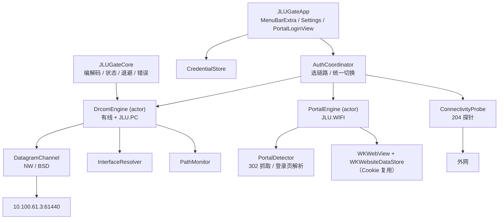
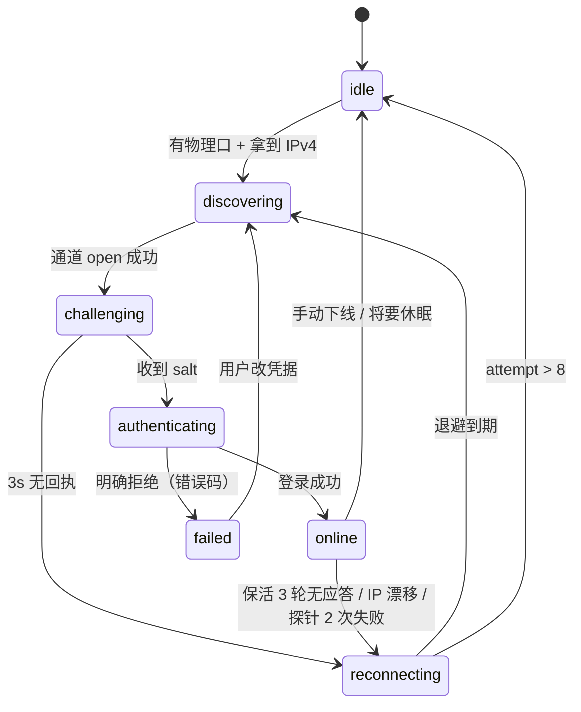
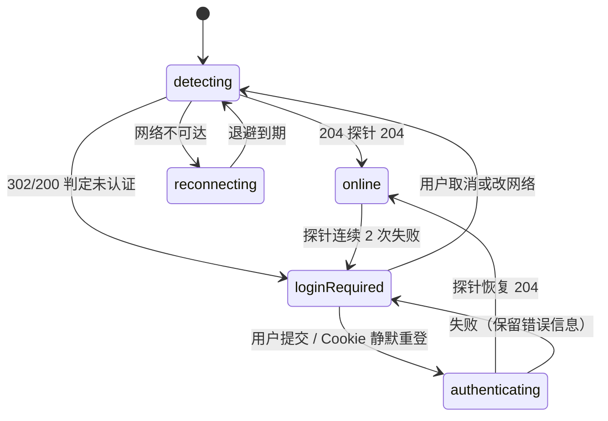

# JLUGate 实施计划 v4.0（施工交接版）

> **角色**：本文件由规划方产出，**施工方按此实施**。施工方不需要再问"协议长什么样"——凡是已知的都在 §1，凡是未知的都在 §1.4，未经验证的字节一律以夹具为准。
> **输入**：`JLU DrCOM Swift Plan/JLUDrCOMSwiftPlan.html`（原始方案）、原始抓包（未入库）（真机抓包）、本机 SDK/工具链实测。
> **状态**：v4.0 · 2026-11-02 · 三条链路 + 地址一次录入 + 路由 helper + MAC 校验 + **macOS 26 / Liquid Glass / 有线唤醒自动重连**

---

## 0. 施工守则（先读这一节）

**必须**

1. 任何报文编码，**只能来自 §1.4 补齐后的夹具**；在夹具到位前，编码器允许"结构正确、字节占位"，但必须在代码里用 `// FIXTURE-PENDING:` 标注，并在 `docs/protocol-findings.md` 登记。
2. 每完成一个里程碑，跑通该里程碑"验收命令"，把输出贴进 `docs/progress.md`。
3. `JLUGateCore` 不得 `import Network/AppKit/Foundation.Networking` —— 它必须能在无网络环境下 `swift test`。
4. 所有对系统的假设（网卡名、IP、端口）走配置或探测，**不得硬编码**（除了 §1.3 的服务器地址/端口，那也有配置项覆盖）。
5. 密钥、账号密码只进 Keychain，日志里不得出现明文，报文日志最多记长度与前 8 字节。

**禁止**

- 禁止照抄原始方案的 `buildLoginPacket`/`buildKeepAlivePacket`（字节布局未验证，见 §2）。
- 禁止用 `URLSession` 做连通性探针（无法绑定出口网卡，TUN 下会被劫持）。
- 禁止把 Portal（`JLU.WIFI`）与 Dr.Com 混进同一个状态机/同一个文件；两者只有"选网卡"这一点共性（§5.4）。
- 禁止把 Portal 做成"抓包重放"当主路径——页面一改就全废，主路径必须是 WKWebView。
- 禁止 helper 执行 shell 字符串、禁止 helper 接受任意目标地址；它只做"给白名单内主机加/删一条 `-ifscope` 的 `/32` 路由"（§6.6）。
- 禁止在本机同时运行官方 `DrClientNS` 与本客户端（两者都要占 UDP 本地端口 61440）。
- **禁止在施工机（环境 A）上发起任何 challenge/login**：账号同一时刻只能一台设备在线（§8.5、§14），本机登录会把用户正在用的有线 Mac 顶下线。

---

## 1. 已证实的事实（来自 原始抓包（未入库））

抓包：`tcpdump -i pktap`，2026-11-02 18:59:45–19:00:19（34.6s / 4456 包）。

**来源机 = 环境 B（另一台有线 Mac）**：装有官方 DrClientNS 且在线；**全程开启代理（TUN 模式）**，抓包就是在这个状态下取的——这一点很重要，见 F7。

**施工机 = 环境 A（本机）**：**没有任何 Dr.Com 环境，做不了任何联网验证**（用户明确）。它只负责编译、单元测试、对 `127.0.0.1` 的模拟网关测试、代码审查。任何“先跑起来看看”的念头在这里都不成立，见 §14。

### 1.1 结论摘要

| # | 事实 | 证据 | 对设计的影响 |
|---|---|---|---|
| F1 | **有线现网走 UDP Dr.COM**（不是 Portal） | `IP 192.0.2.10.61440 > 10.100.61.3.61440: UDP` 反复出现 | 有线只需实现 Dr.Com；Portal 不是它的替代，而是 `JLU.WIFI` 的独立链路（F9） |
| F2 | **客户端源端口固定为 61440**（不是随机 ephemeral） | 两侧端口都是 `61440` | 必须 `bind(localIP, 61440)`；NW 用 `requiredLocalEndpoint` |
| F3 | 保活是 **客户端发起 + 服务器即时应答** 的往返，周期 ≈ **10.4s** | 每轮间隔 10.413 / 10.368 / 9.672s；应答延迟约 0.3–0.4ms | 心跳按"发请求等应答"实现，不是单向下发 |
| F4 | 保活有 **两种帧型交替**：`A: 40→40`（一轮内连发 2 对）与 `B: 38→72` | 见 §1.2 时间线 | 需要两种帧的编码器 + 状态记忆（alternating） |
| F5 | 有线口是 **公网 IP 段**，不是 `10.x`：抓包机 `192.0.2.10`，网关 `192.0.2.1` | ARP：`who-has 192.0.2.1 ... tell 192.0.2.10` | 静态 IP 配置必须允许公网地址；原方案"10.x 内网"假设作废 |
| F6 | 网关 MAC `02:00:00:00:00:02`（LLDP 显示上联 `GigabitEthernet 0/4`） | ARP Reply / LLDP hexdump | 用于诊断面板与 ARP 一致性校验 |
| F7 | **代理 TUN 全程开启时，DrCOM 仍从物理口直出** | 抓包中 `198.18.0.1` 是代理 TUN（fake-ip 段），而 DrCOM 源 IP 是物理口 `192.0.2.10` | 已结案（F10）：这是**路由**决定的，不是客户端绑定 |
| F8 | 34.6s 窗口内 **没有任何 EAPOL/802.1X、没有 DHCP** | `grep -ci eapol` = 0；`bootps/bootpc` = 0 | 官方配置里的 `802.1x` 当前未使用；但窗口太短，不能定论 |
| F9 | **`JLU.WIFI` 走 HTTP 网页认证（Portal），不依赖 Dr.Com 客户端** | 用户确认：连上后浏览器弹登录页，用校园账号登录即可上网 | 这是**第二条完全不同的链路**：没有 UDP 61440、没有心跳包、没有 MAC/IP 校验。必须独立实现（§5.4），不能塞进 Dr.Com 状态机 |
| F10 | **DrCOM 走物理口是"路由放行"的结果**：环境 B 上 `10/8 → 192.0.2.1 via en7`，`default → utun4` | 用户实测 `netstat -rn`（2026-11-02） | 有这条 `10/8`，DrCOM 根本进不了 TUN，与客户端是否绑定无关。**"接口绑定"未被证实，也不是当前可用的前提**（§6.5） |
| F11 | **`JLU.PC` 与有线都必须走 Dr.Com 客户端认证；只有 `JLU.WIFI` 是网页认证** | 用户确认（2026-11-02） | 三条链路 = 两个 Dr.Com（有线 + `JLU.PC`）+ 一个 Portal（`JLU.WIFI`）。`JLU.PC` 复用 Dr.Com 引擎，但**无线侧的帧格式/端口仍需抓包确认**（U9b） |
| F12 | **这条 `10/8` 不是代理"拆分路由"的一部分，而是一条独立的静态条目** | 完整路由表：`1/8`、`2/7`、`4/6`、`8/5` 全部 → utun4；`8/5` 已覆盖 8–15 段，而 `10/8` 作为更具体路由指向 en7 | 代理的覆盖集**包含** 10 段，是这条更具体的静态路由把它"抠"了出来。**谁加的、能否复现，是新的关键未知（U7d）** |
| F13 | **每人的静态网络参数是"一人一份"，必须用户自己录入**：IP、掩码、网关、DNS 都由学校按端口分配，完全一致才能接入；程序无法自动获取，也不会相同 | 用户说明（2026-11-02） | ① 首次启动必须有**纯手工录入**向导，**不得用系统/DHCP 的值填充**；② 系统网络本身也必须是"手动"而非 DHCP，App 要查 `ConfigMethod` 并在是 DHCP 时直接报错；③ `192.0.2.1` 只是该寝室的样例，任何默认值都会被下一个人用错 |
| F14 | **接入还绑网卡 MAC**：用户用的是 USB 转以太网，**每块 USB 网卡的 MAC 都要在学校平台登记过**，对不上就上不了网 | 用户说明（2026-11-02）；环境 B 的有线口 `en7` 即该 USB 网卡（MacBook 自带口是 `en0`） | ① 登录帧里的 MAC 必须读**当前接口**，不能缓存、更不能写死；② 选口时"MAC == 登记值"比网卡名可靠得多；③ 换网卡/换扩展坞必须重新登记，App 要能一眼看出是"MAC 不对"而不是"密码错" |
| F15 | **`JLU.PC` 与有线用同一套地址**（同网段、同网关、同 DNS），且这组地址**只在首次使用时填一次**，之后记住，不反复要求 | 用户说明（2026-11-02） | 架构上**不要按链路拆两套档案**；档案按"账号"存一份，两条链路共用。换账号时才需要重新确认地址 |
| F16 | **官方认证是独立 root 守护进程**：`drcomauth`（PID 686, root）以 `UDP *:61440` 监听，不是 GUI 进程自己发的包 | 用户 `sudo lsof -nP -iUDP:61440` | ① 我们退出官方 App 后**端口仍被占用**，必须检测并引导卸载其 LaunchDaemon；② 路由很可能也由这个 root 守护进程维护（F18） |
| F17 | **系统 DNS 被代理劫持**：`scutil --dns` 里首选是 `198.18.0.2`（fake-ip），学校分配的 `10.10.10.10` 排在后面 | 用户实测 | ① **DNS 不能作为校验失败项**（否则人人都报错）；② 连通性探针**不能走系统 DNS**，否则解析到 fake-ip 直接被代理吃掉，测出来永远是"通" |
| F18 | 退出官方 **GUI** 后，`10/8 → en7` 路由仍在 | 用户 P1 实测 | 与 F16 吻合：路由由 root 守护进程维持，不是 GUI。要彻底验证需 `bootout` 那个 daemon（高风险，非必需） |

### 1.2 抓包时间线（原文摘录 + 间隔）

```text
18:59:48.592477  192.0.2.10.61440 → 10.100.61.3.61440  len 40   ┐ A 型
18:59:48.592813  10.100.61.3.61440  → 192.0.2.10.61440  len 40   │ 第 1 对
18:59:48.593272  192.0.2.10.61440 → 10.100.61.3.61440  len 40   │ 第 2 对
18:59:48.593572  10.100.61.3.61440  → 192.0.2.10.61440  len 40   ┘
        ↓ +10.413s
18:59:59.006827  192.0.2.10.61440 → 10.100.61.3.61440  len 38   ┐ B 型
18:59:59.007191  10.100.61.3.61440  → 192.0.2.10.61440  len 72   ┘
        ↓ +10.368s
19:00:09.375498  … len 40 / 40 / 40 / 40                              A 型（同第一组）
        ↓ +9.672s
19:00:19.048319  … len 38 → 72                                        B 型
```

- 抓包**未包含登录**（challenge/login）：起始时刻客户端已在线，全程只有保活。
- 保活帧长集合：`{38, 40, 72}`，请求 38/40，应答 40/72。
- A 型在一轮里连发两次同样的 40 字节请求；B 型只发一次 38 字节请求。

### 1.3 网络参数（供默认配置与诊断）

#### 1.3.1 环境 B：有线（另一台 Mac，抓包来源）

| 项 | 值 |
|---|---|
| 认证服务器 | `10.100.61.3`，UDP `61440`（配置项可覆盖） |
| 本地绑定端口 | `61440`（与服务器同端口，实测） |
| 有线网卡 | **`en7`** = USB 转以太网（MacBook 自带口是 `en0`；序号随插拔/扩展坞而变，禁止写死） |
| 有线口 IPv4 | `192.0.2.10`（**公网段**，非 10.x） |
| 网关 | `192.0.2.1` / `02:00:00:00:00:02`（**仅该寝室端口，示例值，绝不写死**） |
| 路由表（实测） | `10/8 → 192.0.2.1 en7`；`default → utun4`（代理 TUN）；另一条 `default → 192.0.2.1 en7`（ifscope） |
| 保活周期 | 目标 10s（实测 9.7–10.4s，允许 ±1s 抖动） |
| 服务器应答时延 | 实测 0.33–0.43ms；判定超时用 3s 保守值 |

#### 1.3.2 环境 A：本机 Wi-Fi（**与 JLU 认证网络无关**）

> ⚠️ 本机连的 SSID **不是 `JLU.PC`**，这条 Wi-Fi 与 JLU 认证通道没有任何关系。下表只是"本机上网现状"，**不能当作无线接入学（`wirelessAccess`）的样本**，更不能拿来推断 JLU 无线的网段、网关或认证方式。

| 项 | 值 | 含义 |
|---|---|---|
| 接口 | `en0`（Wi-Fi），`192.0.2.20/24` | 非 JLU 认证网；`10.x` 只是巧合，**不要据此假设 JLU 无线是 10.x** |
| 网关 | `192.0.2.254`（`02:00:00:00:00:03`） | 与 JLU 无关，禁止写死 |
| 默认路由 | `utun4` → `198.18.0.1`（Clash TUN） | 全局流量走代理 |
| `10/8` 路由 | `192.0.2.254` via `en0`（最具体匹配） | 只说明"代理装了 10/8 直连"，与 DrCOM 无关 |
| 联网状态 | `generate_204` 返回 204 | 只能证明"有网"，**不能用于任何认证链路验证**（用户确认本机无 Dr.Com 环境） |

> 结论：环境 A 连"看起来没被 TUN 劫持"都算不上——它根本不在认证网络上。真正的无线接入学，SSID 必须是 **`JLU.PC`**（见 U9）。

**JLU 无线接入的正确定义（本计划采用）**：

- `JLU.PC` → **同一套地址**（F15，与有线同网段/同网关/同 DNS），只是走无线网卡 → Dr.Com 客户端认证（F11）。复用 `DrcomEngine`，无线侧帧格式/端口仍需 U9b 抓包确认。
- `JLU.WIFI` → **HTTP Portal 网页认证**（F9）。独立实现（§5.4），与 Dr.Com 无共用代码。

**两个 SSID 不是同一个东西**，不要用一个 provider 兼容两者。

### 1.4 仍未知（M0 必须补齐，施工方按 §11 M0 执行）

| 编号 | 未知项 | 补齐方式 | 影响 |
|---|---|---|---|
| U1 | ~~challenge / login 的字节布局与摘要算法~~ | **✅ 已结案（2026-11-02）**：布局见 [protocol-findings.md](protocol-findings.md) §2–§5；摘要 A = `MD5(0x03‖0x01‖salt‖password)` 已用真实样本验证通过（§5.2.1） | M1 编码器可正式开工 |
| U2 | 保活帧内部字段（serial、step、校验尾、会话号） | 同上（登录后的前几轮保活也在窗口内） | 心跳是否被判失效 |
| U3 | 服务器是否**强制**源端口 61440 | 对照实验：用随机端口发保活，看有无应答 | 端口绑定是否必须 |
| U4 | ~~认证失败的错误码语义~~ | **✅ 部分结案**：失败帧 `05 00`，原因串在 0x18，实测拿到 `ldap.auth error`；其它原因（欠费/顶号）待补 | 文案直接展示服务器原文 |
| U5 | `JLU.PC` 无线是否在 Dr.Com 之外还叠了 802.1X/EAPOL（有线侧 34.6s 窗口内未见） | 连 `JLU.PC` 抓 10 分钟（含首次关联与断线重连），过滤 `ether proto 0x888e` | 若存在，无线路径要另加 EAPOL 模块，工作量 +3~5 天 |
| U6 | 物理口归属 | `sudo tcpdump -i en7 -k -n "udp port 61440"`（环境 B 的有线口是 **en7**） | 确认报文确实从有线口进出 |
| U7 | ~~F7 的归因~~ | **✅ 已结案（2026-11-02）**：环境 B 实测 `10 → 192.0.2.1 UGSc en7`，`default → utun4`。结论 = **路由放行**，与客户端是否绑定无关 | 产品文案不得写"穿透 VPN"；只能写"代理绕过私有网段时可用"（见 §6.5） |
| U7b | **绑定到接口、但该接口上没有到目标的 route 时，能否发出报文** | 实验：临时在代理里关掉"私有网段直连"，或在测试机 `sudo route delete -net 10.0.0.0/8` 后，用 probe 绑定 en7 发 challenge | 决定"接口绑定"到底是**有效保险**还是**心理安慰**。这条直接决定 §6.5 的实现深度 |
| U7c | `10/8 → en7` 这条静态路由的**来源** | 见 U7d（已合并：F12 表明它不是代理的覆盖集，重点转向"谁在多播这条静态路由"） | — |
| U7d | **谁添加/维持这条 `10/8` 静态路由**：官方 DrClient 的特权 helper？手工配置？校园网下发的附加路由？ | ① `ls /Library/LaunchDaemons \| grep -i -E "doctor\|drcom\|jlu"`；② `launchctl print system/com.doctorcom.DrClientHelper`；③ 退出官方客户端 30s 后 `netstat -rn \| grep "^10 "` 看是否消失 | **本计划里最关键的未知之一**：若这条路由是官方客户端的 helper 加的，那么"无特权"的本应用在 TUN 下**根本复现不了**，必须降级成"引导用户手动加路由"（§6.5） |
| U8 | 账号被其他设备占用时的错误码 | 两台设备先后登录，抓失败方回包 | 决定“顶号/被顶”提示文案与重试策略（§8.5） |
| U9 | ~~`JLU.PC` 用哪套认证~~ | **✅ 已结案（用户确认）**：`JLU.PC` 必须装 Dr.Com 客户端认证，不是网页认证 | 引擎归属 = Dr.Com，复用 `DrcomEngine`，不并入 Portal |
| U9b | 无线侧 Dr.Com 的**帧格式 / 端口 / 源 IP 处理**是否与有线完全一致 | 连 `JLU.PC` 抓一次登录 + 保活（同 P2 流程，只是换 SSID） | 决定是否需要"无线变体"分支；DHCP 场景源 IP 必须每轮重读 |
| U9c | **`JLU.PC` 上是否也有 `10/8` 直连路由** | 连 `JLU.PC` 后跑 `netstat -rn -f inet \| grep -E "^(10|default)"` | ← 高风险：有线的 `10/8 → en7` 很可能是**有线专属**配置。若无线侧没有这条路由，Dr.Com 在 `JLU.PC` 上会被 TUN 吞掉，出现"有线能用、无线不能用"的割裂 |
| U10 | `JLU.WIFI` 的 Portal 流程细节：入口 URL、表单字段、是否有 JS 加密/验证码、成功后跳转标志 | 连 `JLU.WIFI`，抓一次浏览器登录（Chrome DevTools 的 Network 面板即可，无需 root） | 决定 Portal 自动化程度：能静默重放，还是只能 WKWebView 兜底 |
| U11 | Portal 会话多久过期、过期表现 | 保持登录 2–8 小时观察 204 探针 | 决定重登录策略（静默一次 vs 直接弹窗） |
| U12 | `JLU.PC` 无线是否也按 MAC 登记（还是按账号 + 802.1X 证书） | 换一台未登记的机器连 `JLU.PC` 试一次；或看学校平台是否登记 Wi-Fi MAC | 决定无线场景下 MAC 校验的严格程度 |

> 施工方在 U1/U2 补齐前，**必须**先把 §6 的通道、§7 的状态机、§12 的测试骨架做完——这些不依赖字节布局。
>
> **未决问题与"要在哪台机器上跑什么"的完整清单，见 [OPEN-ITEMS.md](OPEN-ITEMS.md)。**

---

## 2. 对原始方案的判定

### 2.1 采纳

物理网卡强绑定、双层心跳、单 Actor 状态机、指数退避 + 抖动、休眠注销/唤醒延迟重连、`SMAppService.mainApp` + `LSUIElement` 菜单栏常驻。

### 2.2 修正（施工方按右列做，不要按原文）

| # | 原文 | 问题 | 改为 |
|---|---|---|---|
| 1 | 登录包"128/334 字节"，代码实拼 66 字节补零 | 字节布局无出处 | 结构先做成可插拔 `PacketLayout`，等 U1 夹具 |
| 2 | `parseSalt` 只判 `response[0] == 0x07` | 保活也是 0x07，必误判 | 解包按 `(kind, subtype, length)` 三元组路由 |
| 3 | 心跳=客户端每 10s 主动发固定帧 | 实测是**请求-应答**且两种帧型交替（F3/F4） | 实现 A/B 帧 + 应答等待 + 交替状态 |
| 4 | 探针用 `URLSession` + 空代理字典"绕过 TUN" | 只绕代理设置，绕不开 utun 路由 | `NWConnection` 绑物理口，手写 `GET /generate_204` |
| 5 | 只设 `requiredInterface` | 不锁源 IP；公网静态 IP 场景解直接错 | 追加 `requiredLocalEndpoint(ip:61440)`；BSD 通道叠 `IP_BOUND_IF` |
| 6 | 随机本地端口 | 实测网关按 61440 通信（F2） | 绑定 61440，失败时明确报端口占用 |
| 7 | `scheduleReconnection` 可从多处调用 | Actor 可重入，多路重连互踩 | `epoch` 世代号 + 任务所有权 |
| 8 | 所有失败 = `NSError` | 无法区分密码错/欠费/端口未授权 | `DrcomError` 枚举 + 错误码表（U4）；另加 `profileMissing(account:)` / `staticConfigMismatch` / `dhcpAssigned` / `gatewayUnreachable` / `ipConflict` / `macMismatch` / `adapterUnplugged` / `interfaceHasNoIPv4` / `capturedByTunnel` / `localPortInUse` / `officialClientRunning` / `accountInUse` / `macInUse` |
| 9 | `ObservableObject` 单例 | Swift 6 严格并发告警 | `@MainActor @Observable` |

### 2.3 编译期已核实的 SDK 事实

- `NWParameters.requiredInterface` 可读写；`requiredLocalEndpoint`、`prohibitedInterfaces` 均可用。
- **`NWInterface` 无公开初始化器**（`swiftc -typecheck` 实测报错）→ 只能从 `NWPath.availableInterfaces` 获取；NW 通道在单元测试中无法构造 → 必须把通道抽象成 `protocol`。
- `IP_BOUND_IF = 25` 存在于 `netinet/in.h`。
- 本机 Swift 6.4.2 / Xcode 27.2 / SDK `MacOSX27.2` / macOS 27.0.1 arm64。

---

## 3. 范围与完成定义

**v1 必做**（用户已确认：有线 + `JLU.PC` + `JLU.WIFI` 三条路都做，先都做出来，IP 后补；要对外分发）

1. **三条接入链路**都能用，且互不干扰：
   - 有线（**用户自行录入的**静态 IP / 掩码 / 网关 / DNS）→ Dr.Com UDP（已抓包证实）
   - `JLU.PC` 无线（**同一套地址**，F15）→ **Dr.Com 客户端认证**（F11，复用同一引擎；帧格式待 U9b 抓包确认）
   - `JLU.WIFI` 无线 → **HTTP Portal 网页认证**，v1 **只做“检测 + Cookie 复用 + 失败弹窗”，不做表单自动化**（决策 D-001）
2. 认证协议只有**两种**（Dr.Com / Portal），但要按**三条链路**做 UI 与配置；架构上用 `AuthProvider` 抽象隔开，不允许把 Portal 硬塞进 Dr.Com 状态机（§5.4）。
3. 菜单栏常驻、无 Dock 图标、开机自启、首次启动引导；**纯 SwiftUI + Liquid Glass**，最低 **macOS 26.0**（用户要求）。
4. **在 TUN 模式代理全程开启的条件下**正常工作，且**断线后无人值守自动恢复**（用户明确要求）。实现路径是三层：路由已放行 → 直连；被 TUN 接管 → 最小特权 helper 加 `-ifscope` 的 `/32` 路由；helper 被拒 → 给用户可复制命令（§6.5）。**不允许静默失败，也不允许"让用户关代理"**。
5. 可签名的 `.app` + `.dmg`，Developer ID 签名 + 公证，Universal（arm64 + x86_64）。
6. 协议层可离线测试：`swift test` 在断网机器全绿。
7. **产物可搬运**：所有验证工具（`jlugate-probe`、`jlugate-daemon`）都是自包含 CLI（universal），拷到另一台 Mac 双击/终端即可跑，不依赖 Xcode 或本机构建目录。

**v1 不做**：802.1X/EAPOL（等 U5）、Portal 的**纯 headless 抓包重放**（改为 WKWebView 兜底，见 §5.4）、Mac App Store、路由器端、流量统计图表、多账号、自动更新（v1 手动下载 DMG）；以及**任何形式的“设备限额规避”**（改 MAC 伪装成同一台设备、抢会话顶号、伪造 NAS 端口），原因见 §8.7。

**完成定义（DoD）**：§11 的 M0–M6（含 M4.5 Portal）全部通过验收命令；`docs/runbook.md` 能让第三方按文档排查"登录失败/闪断/端口占用"三类问题。

### 3.1 产品定位：它是"网络守护进程"，不是"另一个登录工具"

**要被回答的质疑**：`JLU.WIFI` 本来就是浏览器网页认证、不需要任何 App，那为什么要装这个？

按价值强度排序，理由只有四条，前两条是刚需：

| # | 理由 | 为什么浏览器/官方客户端替代不了 |
|---|---|---|
| 1 | **有线休眠唤醒后自动恢复** | 官方客户端休眠必断、必须手动重启（用户实测，体验最差的一环）。浏览器完全无关。这是唯一"不装就解决不了"的场景 |
| 2 | **跨链路自动切换** | 拔网线 → 自动切 `JLU.PC`/`JLU.WIFI` 并认证；插回 → 自动切回有线。浏览器做不到"知道你现在插的是哪个口" |
| 3 | **无感后台** | 常驻菜单栏、不占 Dock、不弹浏览器标签；掉线自动补登，用户不需要知道"认证"这件事发生过 |
| 4 | **状态可见** | 菜单栏一眼看到"在线 / 认证中 / 失败原因"，不用去猜"我到底连上没有" |

**诚实的边界**：

- 如果用户**只用 `JLU.WIFI`**，这个 App 的增量只有"省一个标签页 + 自动补登"，**不足以支撑安装**；
- 所以 v1 的重心必须是**有线 + `JLU.PC`**；`JLU.WIFI` 是"顺手支持"，不是卖点；
- 对外文案不能写"帮你登录校园网"，要写"**让校园网一直在线，你不用管**"。

**对 `JLU.WIFI` 的取舍**（v1）：

- 只做三件事：检测被拦截 → 复用 Cookie 静默登录 → 失败才弹一次登录窗；
- **不做**自动填表/表单逆向（门户结构未公开、改版即失效）；
- 工期紧张时可整体推迟到 v1.1，不影响主体价值。

### 3.2 "在后台活动"的技术要求（这是产品体验的核心）

| 要求 | 实现 |
|---|---|
| 不占 Dock、不进 Cmd-Tab | `LSUIElement=YES` + `NSApp.setActivationPolicy(.accessory)` |
| 不抢焦点 | 平时只有 `MenuBarExtra`；Portal 登录窗**只在需要用户输入时**出现 |
| 不被 App Nap 挂起 | `ProcessInfo.processInfo.beginActivity(options: [.userInitiatedAllowingIdleSystemSleep], reason: ...)`，在 `online` 期间持有 |
| 低功耗 | 心跳 10s（38/40 字节）+ 探针 30s，均无轮询；无定时器风暴 |
| 休眠不空转 | `willSleep` 立即停任务、关通道；`didWake` 等 2s 再重连（§8.3） |
| 开机自启 | `SMAppService.mainApp`，用户可在"登录项"里撤销 |
| 失败不打扰 | 只有"需要用户决策"（密码错/顶号/路由被接管）才发通知，其余静默重试 |

---

## 4. 架构与文件清单



```text
JLUGate/
├── Package.swift                       # swift-tools 6.0，platforms: [.macOS(.v14)]
├── Sources/
│   ├── JLUGateCore/
│   │   ├── Bytes.swift                 # 读写器：显式字节序，越界抛错
│   │   ├── MD5.swift                   # 自实现（RFC1321），不用 CryptoKit.Insecure
│   │   ├── DrcomPacket.swift           # 强类型帧：kind/subtype/fields
│   │   ├── DrcomCodec.swift            # encode/decode，按 (kind,subtype,len) 路由
│   │   ├── PacketLayout.swift          # 可插拔布局（U1 补齐后替换）
│   │   ├── SessionState.swift          # 状态 + 合法转移表
│   │   ├── Backoff.swift               # min(60, 2*2^n)+random(0...3)
│   │   └── DrcomError.swift            # 错误枚举 + 错误码映射
│   ├── JLUGateNet/
│   │   ├── DatagramChannel.swift       # protocol + 错误类型
│   │   ├── NWChannel.swift             # NWConnection + requiredInterface + localEndpoint
│   │   ├── BSDChannel.swift            # socket + IP_BOUND_IF + bind(61440)
│   │   ├── InterfaceResolver.swift     # getifaddrs → 物理口/IPv4/MAC/网关
│   │   ├── PathMonitor.swift           # NWPathMonitor 物理口甄别 + 跃迁检测
│   │   ├── ConnectivityProbe.swift     # NW 裸 HTTP/1.1 204
│   │   ├── DrcomEngine.swift           # actor：Dr.Com 状态机 + 调度 + 自愈
│   │   ├── AuthCoordinator.swift       # 选链路：有线 / JLU.PC / JLU.WIFI
│   │   ├── PortalDetector.swift        # captive portal 判定 + 登录页 URL 解析
│   │   └── PortalEngine.swift          # actor：Portal 会话状态 + Cookie 复用 + 重登
│   ├── JLUGateRouteHelper/             # root LaunchDaemon（SMAppService.daemon）
│   │   ├── main.swift                  # XPC listener + 路由增删（仅 /32 + ifscope）
│   │   └── RouteOperations.swift       # 参数白名单 + route(8) 调用
│   └── jlugate-probe/                  # M0 CLI：发包/收包/导出夹具
│       └── main.swift
├── Tests/
│   ├── JLUGateCoreTests/               # 编解码、MD5 向量、退避分布、状态转移
│   └── JLUGateNetTests/                # FakeChannel + FakeClock 的引擎测试
├── App/                                # Xcode 工程（引用本地 package）
│   ├── project.yml                     # XcodeGen 描述（含 Info.plist/entitlements/签名）
│   └── Sources/{JLUGateApp.swift,MenuContent.swift,SettingsView.swift,LoginItem.swift,PortalLoginView.swift}
├── Tools/mock-gateway/mock_gateway.py  # Dr.Com 回放，可注入丢包/延迟/错误码
├── Tools/mock-portal/portal_server.py   # Portal 模拟：302 → 登录页 → Set-Cookie → 204
├── Fixtures/                           # 抓包样本（§附录 B 格式）
├── docs/{PLAN.md,protocol-findings.md,runbook.md,progress.md}
└── .github/workflows/ci.yml            # swift test（macOS runner）
```

**关键接口**（签名即契约，施工方按此实现）

```swift
public protocol DatagramChannel: Sendable {
    /// 绑定 localIP:localPort，出口固定 interfaceIndex，目标 remote
    func open(localIP: IPv4Address, localPort: UInt16,
              remote: IPv4Endpoint, interfaceIndex: UInt32) async throws
    func send(_ datagram: Data) async throws
    /// 超时抛 .timeout；返回单个 UDP 数据报
    func receive(timeout: Duration) async throws -> Data
    func close() async
}

public protocol Clock: Sendable {
    func sleep(for: Duration) async throws
    func now() -> ContinuousClock.Instant
}

public protocol InterfaceProvider: Sendable {
    func physicalInterfaces() -> [InterfaceSnapshot]   // name/index/ipv4/mac/isWireless
    func snapshot(of name: String) -> InterfaceSnapshot?
}

public struct InterfaceSnapshot: Sendable, Equatable {
    public let name: String          // en0
    public let index: UInt32         // if_nametoindex
    public let ipv4: String?         // 192.0.2.10
    public let mac: String?          // aa:bb:...
    public let isWireless: Bool
    public let isUp: Bool
}

public protocol DrcomCodecProtocol: Sendable {
    func makeChallenge(seed: UInt32) -> Data
    func parseChallengeReply(_ d: Data) throws -> [UInt8]          // salt
    func makeLogin(_ ctx: LoginContext) -> Data
    func parseLoginReply(_ d: Data) throws -> SessionTicket        // 或抛 DrcomError
    func makeKeepAlive(_ kind: KeepAliveKind, ticket: SessionTicket, step: inout UInt16) -> Data
    func parseKeepAliveReply(_ d: Data, kind: KeepAliveKind) throws -> KeepAliveReply
}

/// 两条链路的统一抽象：协调器只依赖这个
public protocol AuthProvider: AnyObject, Sendable {
    var link: AccessLink { get }                     // .wired / .jluPC / .jluWiFi
    func start(using snapshot: InterfaceSnapshot) async
    func stop() async
    var state: AsyncStream<AuthState> { get }        // idle/authenticating/online/failed(reason)
}

public enum AccessLink: String, Sendable, CaseIterable {
    case wired      // Dr.Com UDP，静态公网 IP
    case jluPC      // Dr.Com UDP，与有线共用同一套地址
    case jluWiFi    // HTTP Portal
}

public protocol PortalBrowser: AnyObject {
    /// 由 App 层注入的 WKWebView 能力，Core/Net 不 import WebKit
    func presentLogin(url: URL, prefilled: PortalCredentials?) async -> PortalLoginResult
    func clearCookies() async
}
```

---

## 5. 协议层规范（两套协议并存）

### 5.1 分层

```text
DrcomPacket（语义）  ←→  PacketLayout（字节布局，可替换）  ←→  Bytes（读写器）
```

- `PacketLayout` 是**唯一**允许出现魔法偏移的地方；U1/U2 补齐后只改这里。
- `Bytes` 提供 `readU8/readU16LE/readU32LE/readBytes(n)/write...`，越界抛 `DrcomError.malformed`，禁止 `withUnsafeBytes` 跨字段复用。

### 5.2 帧识别（避免原文的 0x07 误判）

识别优先用 `(kind, subtype, length)` 三元组：

**已由实测抓包确定（见 [protocol-findings.md](protocol-findings.md) §1），不再使用旧文档的 128/334/44：**

| 方向 | 类型:子类型 | 长度 | 归类 | 处理 |
|---|---|---|---|---|
| C→S | `01:03/04/05` | **20** | challenge | 记下序号（`0x1d63`…） |
| S→C | `02:03…` | **76** | challenge ack | 回显序号 + 4 字节可疑 salt + 客户端 IP |
| C→S | `06:01` | **80** | 账号预检上报 | 等 `04` |
| S→C | `04:00` | **25** | 通用 ACK | — |
| C→S | `03:01` | **342** | **login** | 等 `04`(成功) / `05`(失败) |
| S→C | `04:00` | **45** | login 成功 | 进 online |
| S→C | `05:00` | **37** | login 失败 | 原因串在 0x18，直接展示 |
| C→S | `FF` | **38** | 保活 A | 等 72 |
| S→C | `07:01` | **72** | 保活 A 应答 | 含流量统计 |
| C→S | `07:05/06` | **40** | 保活 B | 等 40，序号与应答共用 |
| S→C | `07:05/06` | **40** | 保活 B 应答 | — |

长度未命中 → `DrcomError.unexpectedPacket(length:)`，记日志但不崩。

### 5.2.1 登录摘要（已实测验证，可直接实现）

```swift
// salt 必须取「紧邻本次登录」的那次 Challenge 应答的 0x04..0x07
let digestA = Insecure.MD5.hash(data: Data([0x03, 0x01]) + salt + Data(password.utf8))
```

验证样本（写进单测，跑不通就是实现错了）：

| 输入 | 输出 |
|---|---|
| password=`test-pass-2024`, salt=`49cb720f` | `d030ec3cfa269619e0d3c3224b3e9aa6` |

`0x03A` 处的另外 16 字节两次登录不同、穷举无匹配，**按随机 nonce 处理**（先填随机值，真机验证服务端是否校验；若不校验就不必再查）。

### 5.3 编码约定

- MD5 自实现，附 RFC 1321 三组向量测试（`""`、`"abc"`、长串）。
- 所有多字节字段显式声明字节序（默认小端，个别大端需在 `PacketLayout` 注释里写明依据）。
- 夹具驱动：`Fixtures/*.hex` + `.json` 元数据；`parse → encode` 必须逐字节 roundtrip 一致。
- 密码只在 `makeLogin` 里出现一次，用 `defer` 清零中间 buffer。

### 5.4 Portal 路径（`JLU.WIFI`）—— 与 Dr.Com 并列的第二条链路

**性质**：HTTP 网页认证（captive portal）。没有 UDP 61440、没有 MD5 校验、没有心跳包、也没有 MAC/IP 绑定。**不要试图复用到 §5.1–5.3 的任何组件**，二者唯一的共同点是"都要先选对物理网卡"。

#### 5.4.1 判定流程

```text
1. 探针（绑物理口）：GET http://connectivitycheck.gstatic.com/generate_204
   - 204                    → 已在线，无需认证
   - 200 且体含登录页特征     → 未认证（Portal 直接返页面）
   - 302/307，Location 指向 portal → 未认证，拿到入口 URL
   - 连接失败                → 链路问题，进 reconnecting
2. 若入口是 80/443 劫持式跳转，跟随跳转取出真实登录页 URL 与查询参数
3. 打开登录页 → 认证（见 5.4.2）→ 成功后探针恢复 204
```

#### 5.4.2 认证方式：WKWebView 优先，不做纯 headless 重放

| | WKWebView 内嵌 | URLSession 重放 |
|---|---|---|
| 抗页面改版 | 强（就是浏览器） | 弱（字段/顺序一变就废） |
| JS 加密、一次性 token | 天然支持 | 基本无解 |
| 验证码 | 用户可输 | 无解 |
| 无感程度 | 首次要弹窗；之后靠 Cookie 复用可静默 | 全静默 |
| 实现成本 / 稳定性 | 约 150 行 / 高 | 高且脆 |

**v1 定案**：`WKWebView` + `WKWebsiteDataStore.default()`（Cookie 落盘，重启后仍有效）。

- 首次：菜单栏点击 → 弹出登录窗（`PortalLoginView`）→ 用户输入一次 → 成功后窗口自动关闭、图标转在线。
- 之后：`PortalEngine` 检测到掉线 → 先**静默**用现有 Cookie 请求一次登录页；若被要求重新登录 → 再弹窗（可配置"静默失败自动弹窗"开关）。
- **不做任何 DOM 操作 / 表单填充**（决策 D-001）：登录窗就是一个普通 `WKWebView`，用户自己输。
  理由：门户结构未公开、改版即失效；预填的收益（少打两行字）远小于它带来的脆弱面。
  代码里若残留 `autoFill` 路径，应删除（见 §11 M4.5 变更项）。

#### 5.4.3 会话与保活

- Portal 侧**通常没有心跳**：靠 204 探针（§8.2）判断在线，天然复用现有探针。
- 掉线判定：204 探针连续 2 次失败 → `PortalEngine` 进入 `loginRequired`。
- 会话过期（U11）：先尝试 Cookie 静默重登，失败再弹窗；弹窗频率上限 1 次/5 分钟，避免打断用户。

#### 5.4.4 与 Dr.Com 路径的互斥关系

`AuthCoordinator` 同一时刻只持有一个活跃 provider：

```text
选择顺序：
1. 用户显式指定（有线 / JLU.PC / JLU.WIFI）→ 直接使用
2. 自动：
   a. UDP challenge 有回执        → Dr.Com（有线或 JLU.PC）
   b. 否则若 204 探针返回 302/200 → Portal（JLU.WIFI）
   c. 都没有                      → 提示"当前网络不是校园网"
```

切换链路前必须 `teardown` 旧 provider（否则会出现"Portal 已登录、UDP 还在保活"的双活状态）。

**自动探测的分寸**：探测用的 challenge 只发 1 个、3s 超时、失败不重试，且设置里可关闭（`autoDetect: false`）。原因是它毕竟是对校园网关发未经认证的报文，用户可能不希望 App 在别人的公司网络里"扫一下"。

---

## 6. 通道与接口绑定

### 6.1 双实现（`DatagramChannel`）

| 实现 | 用途 | 要点 |
|---|---|---|
| `BSDChannel` | M0 验证、诊断、兜底 | `socket(AF_INET, SOCK_DGRAM)` → `bind(0.0.0.0:61440)` 或 `bind(localIP:61440)` → `setsockopt(IP_BOUND_IF, &ifindex)` → `connect(remote)` → `DispatchSourceRead` 或阻塞线程 + `poll` |
| `NWChannel` | 生产路径 | `NWParameters.udp` + `requiredInterface`（从 `NWPath.availableInterfaces` 取）+ `requiredLocalEndpoint = .hostPort(localIP, 61440)` + `prohibitedInterfaceTypes` 排除 `[.loopback, .other]` |

**为什么两个都要**：`NWInterface` 无法构造（§2.3），NW 通道在单测里建不起来；而 BSD 通道能对着 `127.0.0.1` 的模拟网关跑完整流程。生产用 NW（享受系统路径/电源管理），BSD 用于验证与故障回退（配置项 `channel: nw|bsd`）。

### 6.2 端口绑定规则

1. 首选 `bind(localIP, 61440)`。
2. 若 `EADDRINUSE`，**先查是谁占的**（F16：官方那个 root 守护进程 `drcomauth` 会一直占着 `*:61440`，退出 GUI 也不会释放）：

```bash
sudo lsof -nP -iUDP:61440     # 期望输出示例：drcomauth 686 root 7u IPv4 ... UDP *:61440
```

   - 占用者是 `drcomauth` / `DrClientNS` → 报 `DrcomError.officialClientRunning`，UI 给出**两步**指引：
     1. 退出菜单栏里的 DrClientNS；
     2. 若仍占用，说明 root 守护进程还在（GUI 退出不会停它）：
        `sudo launchctl bootout system/com.doctorcom.DrClientHelper`
        并说明"这会停掉官方客户端的后台组件，之后要恢复官方客户端需重新安装"。
   - 占用者是自己（上次异常退出）→ `SO_REUSEADDR` 重试一次。
   - 其他进程 → 报 `localPortInUse` 并显示进程名/PID。
3. **不静默改用随机端口**（U3 未验证，很可能直接被网关丢包，表现为"永远收不到回执"）。
4. 记录实际 `getsockname` 结果与占用者到诊断日志。

### 6.3 物理口选择算法

**原则：先看"MAC 是不是登记过的那块"，再看"能不能到认证服务器"，不用 SSID 选口。**

```text
候选 = getifaddrs：AF_INET 有地址 且 isUp
       排除 utun/tun/tap/ppp/ipsec/bridge/awdl/llw/ap 前缀
对每个候选：
    mac == 档案里登记的 MAC？                      // 身份，最强信号
    route(to: 10.100.61.3) 的出口 == 该口？        // 路由层可达
    发一个 challenge，3s 内有回执？                // 链路层真通
打分 = MAC 命中 +8 / 有线 +2 / 有默认路由 +1 / 探测成功 +4
选最高分；同分按接口索引
选定后快照 (name, index, ipv4, mac, gateway, isUSB)，作为一次会话的不可变上下文
```

**为什么 MAC 权重最高**：学校按 MAC 登记（F14），一块 USB 网卡一个 MAC。插到不同 USB 口、换扩展坞，接口名会从 `en7` 变成别的，但 MAC 不变——MAC 才是稳定身份，接口名不是。反之，如果插上另一块没登记过的网卡，就应该**立刻认出"这块不是登记的那块"**，而不是发一串注定失败的认证包。

**多网卡时的行为**：
- 有线场景同时插着两块网卡 → 只认 MAC 匹配的那块；都不匹配 → `failed(.macMismatch)` 并在 UI 里列出"当前所有有线口的 MAC"，让用户自己看是哪块。
- 无线场景（`JLU.PC`）同样适用：内置 Wi-Fi 的 MAC 也要登记。

- **不依赖 SSID**：读 SSID 需要 `CoreWLAN` + 定位权限（macOS 14+ 会弹授权），对一个后台常驻工具是负担。SSID 只作为**可选提示**（用户手动开启"仅在 JLU.PC 上工作"时才读），默认关闭。
- **不为"任意 Wi-Fi"做适配**：本机连的 Wi-Fi 与 JLU 无关（§1.3.2）；无线接入的前提是 SSID 为 `JLU.PC`，否则应当明确提示"当前网络不是校园网"，而不是盲目发 challenge。
  - 判定方式（无权限版）：`10.100.61.3` 的 UDP challenge 无回执 ⇒ 当前不在认证网络；有回执 ⇒ 在。
- 静态模式：用户可锁定接口与 IP；启动时校验接口当前 IP == 配置值，不等则提示"IP 已漂移"；同时校验 MAC == 登记值，不等则 `failed(.macMismatch)`。
- USB 网卡被拔 → 接口从 `getifaddrs` 消失 → `failed(.adapterUnplugged)`，**不要**重试用退避（插回去很快，但空转没意义）；`NWPathMonitor` 检测到恢复后自动重来。
- 新插上的 USB 网卡在 macOS 上往往是一个**新的网络服务**（例如 "USB 10/100/1000 LAN 2"），它的静态 IP 配置是**空的** → 表现为"接口在、但没 IPv4" → `failed(.interfaceHasNoIPv4)`，提示去系统设置给它配地址（或复制 `networksetup` 命令）。
- 无线（`JLU.PC`）与有线一样要求 `ConfigMethod == Manual`、**不支持 DHCP**，且**共用同一份地址档案**；两条链路只是网卡与出口不同。
- 跃迁判定：`(name, ipv4, gateway)` 任一变化 → 作废当前 epoch。

### 6.4 如何证明"没被 TUN 劫持"

```bash
route -n get 10.100.61.3                       # 第一步：看出口是 en7 还是 utunN
sudo tcpdump -i en7  -n -k "udp port 61440"    # 应有来有回（en7 = 环境 B 有线口）
sudo tcpdump -i utun0 -n "udp port 61440"      # 应为空
```

### 6.5 路由优先于绑定（F10 的直接后果，必须照做）

**实测事实**：环境 B 的 `10/8 → 192.0.2.1 via en7`。也就是说，DrCOM 报文根本没进 TUN 是因为**存在这条比 `default` 更具体的路由**，与"我们绑定了物理口"无关。

> 路由来源尚未定性：`10/8` 的 flags 是 `UGSc`（**S = 静态条目**，不是接口自动生成），说明它是被显式写进路由表的——可能是代理的"私有网段直连"、也可能是系统/校园网下发的静态路由。判定方法见 U7c。
>
> **不管来源，产品行为不变**：运行时 `route get 10.100.61.3` 检查出口。

这带来三个必须承认的结论：

1. **不能把"穿透 VPN"当卖点。** 准确的说法是："当代理放行校园网段时可用"。当前两者一旦被 TUN 吞掉（某些 VPN 会），本客户端**不能保证**还能认证。
2. **绑定接口 ≠ 一定发得出去。** 绑定的作用是把路由查找限制在该接口；如果该接口上**没有**到 `10.100.61.3` 的路由（例如只剩 `default → utun`），发包会直接失败（`ENETUNREACH`）。要真正"穿透"，得给该接口加一条 scoped route，而 `route add` 需要 root——本应用刻意**不申请特权**（§10）。此判断待 U7b 实测确认。
3. **产品应该"检查 + 引导"，而不是"硬闯"。** 因此启动/重连时执行：

```text
route = routeGet("10.100.61.3")
if route.interface 是虚拟口 (utun/tun/ppp/ipsec) {
    state = .failed(.capturedByTunnel(interface: route.interface))
    UI: "检测到代理接管了校园网段（10.0.0.0/8）。
        请在代理规则里把 10.0.0.0/8 设为 DIRECT / 直连，
        或关闭 TUN 的「全局路由」后再试。"
    不要发 challenge，不要重试
} else {
    正常流程（绑定该接口 + 源 IP）
}
```

**接口绑定在 v1 里保留**，但定位改成"**保险**"：当代理放行但源地址/出口选择异常时，绑定能把流量钉在正确网卡上；它**不能**替代路由。README 与宣传文案都要按这个口径写。

#### 6.5.1 三层策略（U7d 已基本坐实：DrClient 的 root helper 一直在跑）

`launchctl print system/com.doctorcom.DrClientHelper` 显示 `state = running`、`active count = 2`，程序在 `/Library/PrivilegedHelperTools/`。也就是说，那条 `10/8 → en7` 极可能由它的 root daemon 维持。**我们卸载官方客户端后，这条路由大概率消失，认证在 TUN 下会立刻断。**

因此路由保障分三层，按“权限从低到高”依次尝试：

| 情形 | 检测 | 动作 | 需要 root |
|---|---|---|---|
| A. 路由出口已是物理口 | `route get 10.100.61.3` | 直接用，零特权 | 否 |
| B. 出口是 utun，且 helper 可用 | 同上 + XPC `status()` | helper 加 **`-ifscope` 的 /32 路由**（只影响绑定该接口的 socket） | 是（helper） |
| C. 出口是 utun，helper 未授权/被拒 | 同上 | 给用户可复制的 `sudo route` 命令 + “重新检测”按钮 | 用户手动 |

三层都要用**同一个** `route get` 判定，不能让 B 和 C 走不同逻辑。

#### 6.5.2 无特权时的补救（C 层，必须实现）

应用自己**不加路由**（要 root）。改为"发现问题 → 给一条能复制的命令"：

```text
检测到 route get 10.100.61.3 的出口是 utun4（被代理接管）。
请在终端执行（需要管理员密码）：

  sudo route add -host 10.100.61.3 -ifscope en7 192.0.2.1

执行后点"重新检测"。
（说明：该路由重启/换网后失效，可勾选"登录时提醒我"。）
```

> 用 `-host ... -ifscope` 而不是 `10.0.0.0/8`：**只影响绑定到该网卡的 socket**（正是我们自己的连接），既不改变系统默认路由，也不干扰其它 App。DrClient 的 helper 加的是全局 `10/8`，影响面大得多——我们不学它。
> 命令语法以 macOS 实际 `route(8)` 为准，M2.5 施工时必须先在测试机验证一遍再写进文案。

UI 要点：

- 命令里的网关取**用户档案中录入的网关**（§9.1），不是路由表里的、更不是写死的 `192.0.2.1`；
- 提供"复制命令"按钮 + "我已执行，重新检测"按钮；
- **不静默失败**：用户必须看到原因，否则会以为客户端坏了；
- 记录到诊断包：当时的路由出口、网关、代理接口名。

**顺带结论**：原方案（HTML）里"VPN 会劫持 DrCOM、所以我们用 requiredInterface 解决"的因果链**不成立**——真实情况是路由决定一切。这条必须在交付文档里写清楚，否则用户会遇到"别人的代理能用、我的不能用"却查不出原因。

### 6.6 路由 helper（最小特权、可拒绝、只做一件事）

用户要求"自动重连 + 不与 TUN/VPN 冲突"。B 层要落地，就必须有一个能改路由的组件，而改路由要 root。设计原则：**把权限收窄到"加/删一条 /32 路由"，其余一切仍在无特权进程里。**

| 项 | 规格 |
|---|---|
| 类型 | `SMAppService.daemon(plistName:)`（macOS 13+），plist 放在 App bundle 的 `Contents/Library/LaunchDaemons/dev.jlugate.app.routehelper.plist` |
| 进程 | 独立可执行 `JLUGateRouteHelper`，只链接 Foundation + XPC，**不链接 Network/AppKit** |
| 接口（XPC Mach service） | `ensureRoute(host:gateway:interface:) -> RouteStatus`、`removeRoute(host:)`、`status() -> RouteStatus` |
| 校验 | ① 客户端必须是同一 Team ID 签名（`SecCodeCheckValidity` + audit token）；② `host` 必须是 IPv4 字面量且在 `10.100.61.3` 白名单内（可配置但限制为 /32）；③ `gateway` 必须是该接口当前的默认网关；④ `interface` 必须 `en*` 且不是 utun/tun/ppp；⑤ 只调用 `route(8)` 的参数化形式或 `sysctl(PF_ROUTE)`，**不拼 shell 字符串** |
| 副作用 | 仅 `-ifscope` 的 `/32` 主机路由；`stop()` 与 App 退出时删除；诊断面板可查看当前状态 |
| 授权 | 首次启用时系统弹“允许在后台”，用户可在“登录项”里撤销；**拒绝即降级到 C 层**，不阻断主功能 |
| 卸载 | 提供“移除后台组件”按钮；`SMAppService.unregister()`；卸载器同样清理 |
| 签名 | 与主 App 同一 Team ID、同一 Developer ID，`--options runtime`，随 App 一起公证 |

**为什么值得做**：没有它，"自动重连"在 TUN 场景下是假的——一次网络跃迁或代理重启就可能让认证包落进隧道，用户看到的是"客户端时好时坏"。有了它，重连流程可以做到：`网络跃迁 → removeRoute(旧) → ensureRoute(新) → 重新 challenge`，全程无人值守。

**为什么不做更多**：不加全局路由、不做 BPF 抓包、不装内核扩展、不接管 DNS。权限越大，越难公证、越难让用户信任。

---

## 7. 状态机



| 状态 | 进入动作 | 退出条件 | 超时 |
|---|---|---|---|
| idle | 关闭通道、取消全部任务 | 口就绪 | — |
| discovering | 解析接口、校验 IP、选通道 | 通道 open 成功 / 失败→reconnecting | 2s |
| challenging | 发 20 字节 `01` challenge（带自增序号） | 收 **76** 字节 `02` 回执 / 超时 | 3s |
| authenticating | 发 **342** 字节 `03` 登录包 | 收 **45**(`04` 成功) 或 **37**(`05` 失败) / 超时 | 5s |
| online | 起保活循环 + 探针循环 | 见左 | — |
| reconnecting | teardown、按退避 sleep | 退避结束 | 2s…60s |
| failed | 停自动重试、发通知 | 用户改凭据 | — |

**并发要点**：`DrcomEngine` 是 `actor`；每次进入 `reconnecting` 或用户操作时 `epoch &+= 1`；所有 Task 捕获进入时的 epoch，提交状态转移前校验 `epoch == current`，否则直接返回。心跳/探针 Task 由引擎持有，`teardown` 必须 `cancel()` 并 `await` 其结束（避免"旧任务写新状态"）。

### 7.1 Portal 的状态子集（`JLU.WIFI`）

Portal 没有握手与心跳，状态机是 Dr.Com 的真子集，**不要复用上图的 challenging/authenticating 语义**：



差异点（写代码时注意）：

| | Dr.Com | Portal |
|---|---|---|
| 认证载体 | 自建 UDP 帧 | 浏览器表单 + Cookie |
| 在线判定 | 心跳应答 | 204 探针 |
| 掉线恢复 | 自动重连（可无人值守） | 需要用户在场（除非 Cookie 仍有效） |
| 凭据使用 | 本地算 MD5 | 交给网页，程序不接触明文 |

统一对外只暴露 `AuthState`，UI 不区分底层。

---

## 8. 保活、探针与自愈

### 8.1 保活（按实测 F3/F4）

```text
every ~10s:
    kind = (round % 2 == 0) ? .A : .B
    if kind == .A:  发 40 字节 `07 05 28 00 0b <seq> …` → 等 40 字节应答
                    （同一轮内可能连发两对，实测如此）
    if kind == .B:  发 38 字节 `FF …` → 等 72 字节 `07 01 10 00 …` 应答
    无应答 → missed += 1；missed >= 3 → reconnecting(epoch+1)
    有应答 → missed = 0；seq &+= 1
```

细节（来自实测，见 protocol-findings §7）：

- **B 型（40/40）的序号是"请求与应答共用"的自增计数**：客户端发 `0b 01`，服务器回 `0b 02`，下一次客户端发 `0b 03`……所以本地要按"每收一包 +1"推进，而不是只用请求计数。
- A 型（38/72）首字节是 `0xFF` 不是 `0x07`，不要用 `0x07` 去判断保活。
- 72 字节应答里带**流量/时长统计**（随会话递增），可以直接读出来显示"本次已用流量"，比我们自己统计更准。

- `step`/`serial` 的语义见 U2；在夹具到位前，`step` 用 16 位自增并写入 `PacketLayout` 指定的偏移。
- 服务器若**主动**发来探测（U2 未定），通道的 `receive` 循环需能识别并原样回执——通道层不设"只收应答"的假设。

### 8.2 探针（TUN 安全）

- 目标：`http://connectivitycheck.gstatic.com/generate_204`，失败回落 `http://cp.cloudflare.com/generate_204`。
- **必须自己解析 DNS，不能用系统 DNS**（F17：系统 DNS 是代理的 fake-ip `198.18.0.2`，用它解析会得到 `198.18.x.x` 之类的假地址，探针被代理吞掉，永远返回 204，等于没测）。
  - 做法：向档案里的学校 DNS（如 `10.10.10.10`）发一次 **UDP 53 查询**，socket 同样绑定物理接口；拿到 A 记录后，再连**字面 IP**。
  - 学校 DNS 不通时，回落一张内置的 IP 表（编译期常量），仍然带正确的 `Host` 头。
- 实现：`NWConnection` + TCP + `requiredInterface`，手写 `GET /generate_204 HTTP/1.1\r\nHost: <域名>\r\nConnection: close\r\n\r\n`。
- 判定：首行含 ` 204 ` → 健康；`200/30x` → 被 Portal 拦截；连接失败/超时 3s → 异常。
- 周期 30s；连续 2 次异常 → `reconnecting`。
- 探针与心跳**共用** `InterfaceSnapshot`（同一 epoch 内不变）。

### 8.3 休眠/唤醒（**有线必须自动恢复，这是本项目的核心痛点**）

用户反馈：官方客户端在系统休眠/暂停后，有线网络瞬间断，**必须手动重启客户端**才能重连——体验极差。我们的第一优先级之一就是消灭这个动作。

**为什么旧客户端会卡死**：休眠时网卡下电、socket 静默失效，唤醒后旧 fd 还在但写入必然失败（`ENETDOWN` / `EBADF`），而它没有重建通道的逻辑，于是"看着在运行、实际已死"。

**正确做法（四步，缺一不可）**：

1. `NSWorkspace.willSleepNotification`：**直接 `close()` 通道 + cancel 所有定时任务**，状态置 `idle`。
   - **不发 Logout 报文**：用户确认官方客户端平时根本不点注销、直接退进程；服务器会按 3 个心跳周期自然超时，我们不必逆向注销包（U-logout 关闭）。
2. `NSWorkspace.didWakeNotification`：**不要立刻重连**，先等 2s，再进 `discovering`。
3. `discovering` 阶段必须**重新获取一切**，不能复用唤醒前的缓存：
   - 重新 `getifaddrs` 取接口名与 **ifindex**（唤醒后索引可能变化）；
   - 重新读接口 IPv4 与 MAC（USB 网卡重新枚举时可能变成新的网络服务）；
   - 重新 `route get 10.100.61.3` 判定出口（代理 TUN 可能重新接管）；
   - 重新 `ensureRoute`（helper）或重新校验。
4. **重建 socket**：旧 fd 一律丢弃。判断依据是 `send()` 返回 `ENETDOWN/EBADF/ENXIO`，或 `receive` 连续超时；**不要**试图在旧 fd 上"重试一次看看"。

补充：

- 唤醒后接口可能短暂 `UP` 但没有 IPv4（DHCP 未完成/静态配置未生效）→ 轮询最多 5s，超时进 `failed(.interfaceHasNoIPv4)`。
- 睡眠期间**不要**让探针/心跳继续空转（会被 App Nap 挂起，醒来后补发一堆过期包）——`willSleep` 时必须 cancel。
- 验收：合盖 2h 唤醒后 **≤5s 自动回到在线**，期间用户不碰键盘鼠标、不点任何按钮。

### 8.4 退避

`delay = min(60, 2 × 2^min(attempt,5)) + Double.random(in: 0...3)`，attempt 从 1 起；>8 次 → `idle` 并在菜单栏显示“网关无响应，点击重试”。

### 8.5 账号独占（同一账号只能一台设备在线）

这是 JLU 的硬约束：**同一账号同一时刻只允许一台设备在线，有线无线都一样**。它会改变重试策略：

| 场景 | 服务器表现（用户实测） | 客户端必须做的事 |
|---|---|---|
| 登录时账号已在别处在线 | 提示**“账号在别处登录”** | **不自动重试**，进 `failed(.accountInUse)`，原文照抄服务器提示；给 `重试` 按钮（用户可能刚把另一台关掉） |
| 同一 MAC 被别的设备占用 | 提示**“另一台设备已经占用该MAC”** | 进 `failed(.macInUse)`，文案保留原文，并附上本机当前 MAC 与"是否多人共用同一块廉价网卡"的提示 |
| 自己在线时被别处顶掉 | 保活突然无应答，随后外网被拦 | 保活连丢 3 轮 → `reconnecting` 一次；若立刻再登录失败 → `failed(.accountInUse)`，**不再循环重试** |
| 用户在本机切换有线↔无线 | 旧会话可能仍占着 | 先 teardown 再认证；提示“另一会话可能仍在，最多 3 个心跳周期（约 30s）自动释放” |

**关于"不点注销、直接退进程"**（用户实际习惯）：退出 App 时只做 `close()` + 停止心跳，**不发 Logout**（服务器那侧的注销包格式未逆向，且用户从不使用它）。代价是退出后服务器要等约 3 个心跳周期（30s）才释放会话；UI 在退出确认里如实说明：“退出后约 30 秒，其它设备才能登录本账号”。

**禁止**：`reconnecting` 状态下无限重登。两台设备同账号互抢会形成顶号乒乓（A 顶 B、B 顶 A），比掉线更难排查，也会触发学校风控。重连计数与“账号冲突”必须分开计。

### 8.6 “自动断线重连”的验收口径（用户明确要求，按这个测）

“自动”指**用户不碰任何东西**。用可量化指标定义，避免做成“看起来在转圈”：

| 场景 | 恢复上限 | 判定 |
|---|---|---|
| 拔掉网线再插回 | ≤ 5s | 无需点击，图标自动回到在线 |
| 切换 `JLU.PC` ↔ 有线 | ≤ 8s | 自动重新挑战，不弹错误 |
| 代理重启 / 改规则导致路由变化 | ≤ 10s | `RouteGuard` 重新判定 + 重新 ensureRoute |
| 合盖 2h 唤醒 | ≤ 5s | 唤醒后 2s 静默 + 3s 认证 |
| 服务器端踢线（账号在别处登录） | — | **不自动重试**，进 `failed` 等用户（§8.5） |
| 网关彻底无响应 | — | 退避到 60s，UI 显示“网关无响应”，不刷屏 |

补充要求：

- 重连期间**不得**留下旧 socket / 旧定时器（`teardown` 必须 await 任务结束）。
- 每次重连都要重新 `route get` 判定，不能缓存上一次的结论（换网后路由会变）。
- 重连成功后，把“本次恢复耗时”写进诊断日志，便于事后定位是哪一层慢。

---

### 8.7 为什么不与“设备限额”对抗（调研结论）

> 结论先说：**不是技术做不到，而是做不到还不伤别人。**

**服务端凭什么判断“这是两台设备”？** 从登录包与实测报错可以还原：

| 依据 | 来源 |
|---|---|
| 账号 | 登录包 `0x014`（32 字节定长） |
| **MAC** | 登录包 `0x14C`，且会被网关与交换机 ARP 表交叉比对 |
| IP | 登录包 `0x051`，必须与端口学习到的地址一致 |
| 客户端指纹 | 版本串 `0x0C0`（`25.6.0`）、主机名 `0x06E` |
| 接入端口 | 帧从哪个 NAS 端口进来（服务端可见，我们看不到） |

关键证据：实测错误串**区分**“账号在别处登录”与“**另一台设备已经占用该 MAC**”——说明 **MAC 是服务端会话的主键之一**，不是可有可无的字段。

**三条“伪装”思路逐一分析：**

| 思路 | 表面上 | 实际后果 |
|---|---|---|
| ① 两台设备改成同一个 MAC | 服务端可能当成一台 | 同网段内两台设备同 MAC → 交换机 MAC 表在两个端口间反复学习（flapping），双方间歇断网，开启 port-security 的交换机可能直接关端口；跨网段则 NAS 端口不同，服务端仍分得清。**伤及同交换机的其他同学** |
| ② 伪造客户端指纹（版本/主机名） | 骗过“是不是官方客户端” | 与设备限额**完全无关**；而且我们已经照抄 `25.6.0`、`DrCOM` 魔数与主机名格式 |
| ③ 抢会话（谁最后登录谁在线） | 技术上“能用” | 形成顶号乒乓，可能触发学校风控；双方都处在“随时被踢”的状态，体验最差 |

**代价落在谁身上**：自己的账号（可能被停用）、同一交换机的同学（MAC 抖动）、以及明确违反校规。

**产品选择**：**检测、告知、不抢**（§8.5）。被顶号时进 `failed(.accountInUse)`，原文展示服务器提示，给“我要用这台”按钮由用户决定；绝不自动重登去抢。

**如果确实需要两台同时在线**：走学校的多终端套餐/自助申请，或用一台机器做热点（需先确认校规是否允许）。

---

## 9. 应用层与系统集成

| 项 | 实现 |
|---|---|
| 名称 | **JLU Gate**（显示名带空格，bundle 名 `JLUGate`，Bundle ID `dev.jlugate.app`） |
| 形态 | `MenuBarExtra`（`.menuBarExtraStyle(.window)`），`LSUIElement=YES`，`NSApp.setActivationPolicy(.accessory)`，**纯 SwiftUI** |
| 视觉 | **Liquid Glass（macOS 26+）**：状态卡片用 `GlassEffectContainer(spacing: 12)` 包裹，`VStack{…}.glassEffect(.regular.tint(statusColor).interactive(), in: .rect(cornerRadius: 16))`；按钮用 `.buttonStyle(.glass)`；不要自绘毛玻璃素材 |
| 图标四态 | 离线（灰）/ 认证中（转圈）/ 在线（实心）/ 错误（感叹号 + 角标） |
| 菜单内容 | 状态文案（含"当前链路：有线 / JLU.PC / JLU.WIFI"）、当前接口与 IP、登录/下线、**打开 Portal 登录页**、设置、复制诊断信息、退出 |
| 设置页 | 账号、密码（Keychain）、**链路（自动 / 有线 / `JLU.PC` / `JLU.WIFI`）**、**静态网络参数（IP / 掩码 / 网关 / DNS，见 §9.1）**、接口锁定（可选）、服务器地址端口（高级）、开机自启、日志级别；**不暴露 SSID 选择**——不是 `JLU.PC` 就直说“当前网络不是校园网” |
| 网络参数档案 | 一人一份，可**导出为文本卡片 / 二维码**，换机或重装时扫码/粘贴恢复（**人写的卡片，不是系统读数**）；表单不做自动填充（见 §9.1） |
| Portal | 独立窗口（`PortalLoginView`：`WKWebView` + 顶部说明 + "记住我"），首次必须人工点一次；之后靠 Cookie 静默；窗口可关闭不退出 App |
| 凭据 | `kSecClassInternetPassword`，`service="dev.jlugate.app"`，`account=学号`；密码不落 UserDefaults |
| 配置 | `~/Library/Application Support/JLUGate/config.json`（非敏感项），带 schema 版本号 |
| 自启 | `SMAppService.mainApp.register()/unregister()`，`status == .requiresApproval` 时引导用户去"登录项" |
| 单实例 | `NSRunningApplication` 查重 + 端口占用检测；已有实例则激活它 |
| 日志 | `OSLog(subsystem: "dev.jlugate.app", category: <module>)`；文件日志滚动上限 2MB |
| 诊断包 | 导出 `最近 500 行日志 + getifaddrs 快照（含每口 name/MAC/IPv4/isUSB）+ 路由表 + 当前配置（脱敏）` 的 zip |

**Liquid Glass API（已在本机 SDK `MacOSX27.2` 的 `SwiftUICore.swiftinterface` 中核对，全部 `macOS 26.0+`）**：

```swift
Glass.regular / .clear / .identity
Glass.tint(Color?) / .interactive(Bool = true)
func glassEffect(_ glass: Glass = .regular, in shape: some Shape = DefaultGlassEffectShape()) -> some View
GlassEffectContainer(spacing: CGFloat? = nil) { ... }
func glassEffectID(_ id: (some Hashable & Sendable)?, in namespace: Namespace.ID) -> some View
func glassEffectUnion(id: (some Hashable & Sendable)?, namespace: Namespace.ID) -> some View
GlassEffectTransition
```

> 注意：`Glass` 在 `visionOS` 上标为 unavailable；本应用只发 macOS，无影响。executor 不要去用 `NSVisualEffectView` 自己糊一层——系统玻璃与自定义材质叠在一起会脏。

### 9.1 首次启动向导（必须做，因为静态参数无法自动化）

**背景**：学校按宿舍端口给每个人分配**固定**的 IP、掩码、网关、DNS，四者必须完全正确才能接入；程序无法推导，也不会人人相同（`192.0.2.1` 只是某个寝室的样例）。所以这是产品的第一道坎——填错就上不了网，而且用户往往记不住。

向导分四步，第 3 步是核心；**整个向导只在"首次使用"或"换账号"时出现**，之后不再打扰：

1. **选择链路**：有线 / `JLU.PC` / `JLU.WIFI`（可先选"自动"）。
2. **账号密码**（写 Keychain）。
3. **网络参数**（有线与 `JLU.PC` 共用，只填一次）：
   - **只填一次，长期记住**（F15）：有线和 `JLU.PC` 共用同一组地址，所以只录一份，不存在"两条链路两套地址"。
   - 五个输入框：`IP`、`子网掩码`、`网关`、`DNS`（允许多个，逗号分隔）、**登记 MAC**。
   - 首次跑完向导后，**这些值写进档案，之后打开 App 不再追问、也不预填一遍让用户确认**；设置页里以只读形式展示，要改才进编辑态。
   - **全部手填，不做"自动填入"**：这几项是学校按端口分配的固定值，**只能人工照抄**；系统里自动拿到的（DHCP 分配的）一律不能用，抄进来就是错的。
   - 表单默认**全空**。唯一的辅助是只读的「和系统当前值对一下」：把系统现有配置显示在旁边供比对（灰色、不可编辑），明确标注"仅供核对，**不要照抄 DHCP 分到的值**"。
   - **登记 MAC** 同样手填；旁边显示"当前接口 en7 的 MAC：xx:xx:…"（`getifaddrs` 的 `AF_LINK`，无需权限）供核对，但不自动写入——换卡时用户必须自己改成新卡的 MAC 并去学校平台登记。
   - 实时校验（输入即验，不等提交）：
     | 校验 | 规则 | 失败提示 |
     |---|---|---|
     | 格式 | IPv4 字面量 / 掩码 0–32 或点分 | “IP 格式不对” |
     | 同网段 | `ip & mask == gateway & mask` | “网关不在你所在的网段里” |
     | 网关存在 | ARP 请求网关，2s 内有 reply | “网关没有响应，检查网线/端口” |
     | IP 未被占用 | ARP 探测该 IP 是否有别的设备应答（**只读探测**） | “这个 IP 已被占用，可能填错了” |
     | DNS 可用 | 向档案里的学校 DNS 发一次 UDP 53 查询，3s 超时 | “DNS 没有响应（可跳过）”。**仅提示**：开着代理时系统 DNS 必然显示 `198.18.0.2`，这不是错误 |
     | MAC 一致 | 当前接口 MAC == 登记 MAC | “这块网卡的 MAC 和登记的不一样，需要重新登记才能上网” |
     | 系统是否手动 | `ipconfig getsummary <if>` 的 `ConfigMethod` == Manual（不是 DHCP） | “这个网络接口现在是自动获取地址，必须改成手动并填入学校分配的 IP/掩码/网关/DNS” |
     | 档案是否存在 | 当前账号已有档案（首次为空则走向导） | “还没有这个账号的网络档案” |
   - 「测试并保存」：全部通过才允许保存；可勾选"我知道错了也能改"跳过（不阻断高级用户）。
   - 「我忘了参数」入口：只指向学校自助平台 `ip.jlu.edu.cn` / 网络中心，**不要**建议从系统里"捞"——系统里的值可能是 DHCP 给的，捞回来就是错的。
4. **完成**：展示一张"我的网络档案"卡片（IP/掩码/网关/DNS/账号），提供**复制 / 存为图片 / 生成二维码**——这就是用户"需要记住"的东西。

**USB 网卡的两个必踩坑（写进文案，别让用户猜）**：

1. **接口名会变**：`en7` 插到另一个口可能变 `en8`，但 MAC 不变 → 一切按 MAC 走，不按名字。
2. **新口 = 新网络服务**：macOS 会给"新位置的同一块网卡"建一个新的网络服务，静态 IP 往往是空的；用户会以为"同一个网卡怎么突然不行了"。App 应该直接说："检测到 `en8`（MAC 与登记值一致）但没有配置 IP，请在系统设置 → 网络 里为它填写 IP/掩码/网关。"

**运行时**（比向导更重要）：

- 每次启动与重连，先查 `ConfigMethod`：
  - **是 DHCP** → `failed(.dhcpAssigned)`：“这个网络接口是自动获取地址，必须改成手动并填写学校分配的值”（有线和 `JLU.PC` 都适用），给可复制的 `networksetup -setmanual`；**不继续认证**（DHCP 地址下认证必然失败，继续发只会让人以为是密码错）。
  - 是手动 → 继续比对。
- 比较"**当前链路**档案里的 IP/掩码/网关/DNS"与"网卡实际值"：
  - 不一致 → `failed(.staticConfigMismatch)`，逐项列出**期望值 vs 实际值**（不要只说“不一致”），并给一键复制 `networksetup -setmanual "…" IP MASK GW`（让用户自己执行，App 不擅改系统网络）。
  - DNS 不一致 → **仅提示，不阻断**：一是代理会改 DNS（F17），二是 DNS 不影响认证本身。提示文案要说明“检测到 DNS 被代理接管，这不影响认证”。
  - 一致但网关 ARP 不通 → `failed(.gatewayUnreachable)`。
- **绝不**把 `192.0.2.1`、`10.10.10.10` 之类写成默认值；空表单 + 必填校验。
- **绝不**用 DHCP 分配到的值“智能填充”表单；宁可让用户多打几行字，也不能让他用错地址还以为是软件坏了。

### 9.2 MAC 一致性与插拔处理（USB 网卡特有）

| 事件 | 检测 | 行为 |
|---|---|---|
| 换了一块没登记的 USB 网卡 | 候选口 MAC 全都不等于登记值 | `failed(.macMismatch)`，列出所有有线口的 `接口名 / MAC / 是否有 IP`，提示"到 ip.jlu.edu.cn 登记或换回原网卡" |
| 同一块网卡换 USB 口 | 新接口 MAC == 登记值，但没 IPv4 | `failed(.interfaceHasNoIPv4)`，给 `networksetup -setmanual` 命令 |
| 拔掉网卡 | 接口消失 | `failed(.adapterUnplugged)`，不进退避循环；插回后自动重来 |
| 同时插两块 | 多口 MAC 不同 | 只认登记值那口；日志记录被忽略的口 |
| 登录成功但被网关拒 | 错误码（U4） | 若错误码指向 MAC/IP，直接翻成"MAC 或 IP 与登记不符"，附当前值 |

额外要求：

- 登录帧里的 MAC **每次从接口现读**，不缓存（换卡后缓存会害死人）。
- 诊断包必须包含：每个物理口的 `name / MAC / IPv4 / isUSB / 是否有默认路由`。用户报"连不上"时，这一屏就能定位一半问题。

**前置**：本机实测**未安装** XcodeGen / swiftlint / xcsift，需先 `brew install xcodegen`；不引入工具的话只能在 Xcode GUI 里手建工程，CI 无法复现，故仍建议 XcodeGen。

**Bundle / 工程参数（XcodeGen `App/project.yml`）**

```yaml
name: JLUGate
options: { bundleIdPrefix: dev.jlugate, deploymentTarget: { macOS: "26.0" } }
settings:
  base:
    PRODUCT_BUNDLE_IDENTIFIER: dev.jlugate.app
    MARKETING_VERSION: "1.0.0"
    CURRENT_PROJECT_VERSION: "1"
    ARCHS: "arm64 x86_64"
    ONLY_ACTIVE_ARCH: NO
    CODE_SIGN_IDENTITY: "Developer ID Application"
    CODE_SIGN_STYLE: Manual
    ENABLE_HARDENED_RUNTIME: YES
    ENABLE_APP_SANDBOX: NO          # 见 §10
    SWIFT_STRICT_CONCURRENCY: complete
    SWIFT_VERSION: "6.0"
```

---

## 10. 分发（用户已确认要对外分发）

| 步骤 | 命令 / 说明 |
|---|---|
| 证书 | Apple Developer Program（¥688/年）→ `Developer ID Application` |
| 签名 | `codesign --force --deep --options runtime --sign "Developer ID Application: <名字> (<TEAMID>)" JLUGate.app` |
| 公证 | `ditto -c -k --keepParent JLUGate.app JLUGate.zip` → `xcrun notarytool submit --apple-id … --team-id … --password <app-specific-pwd> --wait` |
| 装订 | `xcrun stapler staple JLUGate.app` |
| 打包 | `hdiutil create -volname JLUGate -srcfolder dist -ov -format UDZO JLUGate.dmg`，DMG 也要签名+公证 |
| 校验 | 干净机器上 `spctl -a -vvv -t exec JLUGate.app` 必须 `accepted` |
| 沙盒 | **关闭**。理由：主进程只需出站 UDP，本可沙盒；但路由 helper 是 LaunchDaemon，且若 U5 证实需要 802.1X/BPF 沙盒必然要拆。用 Developer ID 直发不受 MAS 限制 |
| 后台组件 | `Contents/Library/LaunchDaemons/dev.jlugate.app.routehelper.plist` + `Contents/MacOS/JLUGateRouteHelper`；**必须与主 App 同一 Developer ID 签名**，否则 XPC 校验与公证都会失败 |
| 公证注意 | `--deep` 已不推荐：按“helper → framework → app”由内向外逐层 `codesign`，再整体公证；`spctl` 校验前先 `stapler validate` |
| 架构 | Universal（官方客户端也是 universal）；`lipo -info` 校验 |
| 最低系统 | **macOS 26.0**（`Glass` 要求 26.0；用户明确要求 Liquid Glass 与原生 SwiftUI） |

**注意**：非沙盒 + `SMAppService.mainApp` 需要 app 位于 `/Applications`（或用户目录下的 Applications）才能稳定注册；DMG 里放一个 `Applications` 符号链接并引导拖入。

---

## 11. 里程碑与验收

> 估时按"一个施工 agent 连续作业"计；每步都必须留下 `docs/progress.md` 记录。

### M0 · 工具先行（0.5–1 天）

> **约束**：施工机（环境 A）**没有 Dr.Com 环境，做不了任何联网验证**；而且账号独占（§8.5），就算有环境也不能随便登。所以 M0 的产物是**能拿到环境 B 去跑的 CLI + 一份用户照着做就行的小抄**，施工方本机只编译、只读源码。

任务：

1. `git init` + 骨架目录。
2. 写 `jlugate-probe`（先 BSD 通道），支持 `--interface/--local-port/--host/--port/--count/--hex-dump/--repeat`，输出可直接粘进夹具的文本。
3. 写 `docs/capture-protocol.md`：给用户的**傻瓜式操作清单**（在哪台机器、什么顺序点、抓什么、回传什么）。
4. 用 `swift build -c release` 产出 universal 二进制，供拷贝到环境 B。

```bash
# 施工机：只编译、只打包
swift build -c release
lipo -create -output dist/jlugate-probe .build/*/release/jlugate-probe   # 或直接 xcodebuild ARCHS="arm64 x86_64"
```

```bash
# 环境 B（用户执行，施工方不碰）：
# 0) 先退出官方 DrClientNS，确认没有进程占用 UDP 61440
sudo lsof -nP -iUDP:61440
# 1) 开抓（含 payload），然后在官方客户端上"注销 → 重新登录"
sudo tcpdump -i en7 -n -s 0 -X "udp port 61440" -w ~/Desktop/login.pcap
# 2) U6：确认接口归属
sudo tcpdump -i en7 -k -n "udp port 61440" | head
# 3) U3：换随机源端口对照（用 probe）
./jlugate-probe --mode bsd --local-port 0 --count 3
# 4) U7：贴一张路由表（不占网、不打扰）
netstat -rn -f inet | grep -E '^(10|default)'   # 看 10/8 到底走 en7 还是 utun
```

验收：`Fixtures/` 有完整 `challenge → login → keepalive` 序列（文本 + pcap）；`docs/protocol-findings.md` 的 U1–U8 全部有结论；probe 能在环境 B 收到服务器应答。**若用户暂时无法配合，M1 用 `PacketLayout` 占位结构继续推进，不阻塞。**

### M1 · 协议核心（2–3 天）

任务：`JLUGateCore` 全部文件 + 测试；用 M0 夹具做 roundtrip。

```bash
swift test --filter JLUGateCoreTests
```

验收：夹具 100% roundtrip；MD5 向量通过；`Bytes` 越界/截断用例全绿；未知帧不崩溃。

### M2 · 通道与引擎（2–3 天）

任务：`BSDChannel`/`NWChannel`、`InterfaceResolver`、`PathMonitor`、`SessionEngine`、`Clock` 注入、`FakeChannel`。

```bash
swift test --filter JLUGateNetTests        # FakeClock 虚拟 24h
python3 Tools/mock-gateway/mock_gateway.py --fixtures Fixtures/login.hex --loss 0.3
swift run jlugate-probe --mode bsd --host 127.0.0.1 --port 61440 --loop 5
```

验收：对模拟网关完成 `idle→online` <1s；30% 丢包下 3 轮内触发重连并恢复；虚拟 24h 无 Task 泄漏（`Task` 计数归零断言）；接口名/IP 变更注入后 epoch 翻转。

### M2.5 · 路由 helper（2 天）

任务：`JLUGateRouteHelper`（XPC daemon）、`dev.jlugate.app.routehelper.plist`、客户端 `RouteGuard`（`route get` 判定 + 三层降级）、设置页授权 UI、卸载清理。

```bash
# 离线可测：helper 的路由参数校验、白名单、拒绝非法入参
swift test --filter RouteGuardTests
# 手动验收（需要一台能加路由的机器）
sudo route -n get 10.100.61.3
sudo route add -host 10.100.61.3 -ifscope en7 192.0.2.1   # 先验证语法
sudo route delete -host 10.100.61.3
```

验收：helper 安装后出现在“系统设置 → 通用 → 登录项 → 允许在后台”；拒绝授权时 App 自动走 C 层且不崩；`ensureRoute` 只在目标出口是 utun 时生效；App 退出后 `/32` 路由被删除；`codesign -dv` 与主 App TeamID 一致。

### M3 · 真机联调（2 天，**必须在环境 B 上执行**）

> 施工机做不了这一步：账号独占 + 本机无有线口。真机联调 = 施工方打包 → 用户拿到有线 Mac 上跑 → 回传日志。排期需与用户约定"独占窗口"（此时环境 B 会短暂离线）。

```bash
# 环境 B：
sudo tcpdump -i en7 -n "udp port 61440" &   # 同时跑（环境 B 有线口）
./jlugate-daemon --log-level debug           # 或 App 的 CLI 模式
```

验收：真机连续在线 8h 不掉线；拔网线 500ms 内进 `reconnecting`，插回 3s 内 `online`；合盖 2h 唤醒 3s 内恢复；`utun` 上抓不到任何 61440 报文。

### M4 · 菜单栏应用 + 首次向导（3 天）

任务：`MenuBarExtra`、设置页、**§9.1 四步向导**（纯手工录入 + 六项校验 + `ConfigMethod` 检查 + 档案卡片导出）、Keychain、`SMAppService`。

验收：`LSUIElement` 生效（Dock 与 Cmd-Tab 无图标）；自启注册后"系统设置 → 登录项"可见并可关闭；Keychain 读写正常；设置页改配置即时生效；单实例检查有效。向导专项：空表单不能提交；填一个不在同网段的网关能被拦下；把系统网卡 IP 改掉后 App 报 `staticConfigMismatch` 而不是"登录失败"；**换一块 MAC 不同的 USB 网卡后 App 报 `macMismatch` 并列出所有有线口**；**把接口切回 DHCP 后 App 报 `dhcpAssigned` 且不发认证包**；**首次填完后再启动，不得再次弹出地址表单**；**切换账号时能按账号载入各自档案**；导出的档案卡片能在另一台机器粘贴还原。

### M4.5 · Portal 路径（`JLU.WIFI`，1 天；**施工方已提前完成，剩余为收尾**）

任务：`PortalDetector`（302/200 判定）、`PortalEngine`（actor）、`PortalLoginView`（纯 WKWebView + Cookie）、`AuthCoordinator` 链路切换、`Tools/mock-portal/portal_server.py`。

**决策 D-001（2026-11-03）**：v1 不做表单自动化。收尾项：
1. 删除 `PortalEngine.Configuration.autoFill` 与其传递链（`PortalEngine.swift` → `PortalBrowser.presentLogin(credentials:)`）；
2. `presentLogin` 只接收 `url`；
3. 设置页不放任何“自动填写”开关；
4. 验收不看“预填成功”，只看“能弹窗、能检测、Cookie 能复用”。

```bash
# 离线可测部分（施工机）
python3 Tools/mock-portal/portal_server.py --port 8080 --mode redirect-login   # 302 → 登录页
swift test --filter PortalTests                                                # 判定逻辑
./jlugate-portal-probe --url http://127.0.0.1:8080/generate_204               # 探测分类
```

验收（**离线**）：本地 mock portal 四种模式（直连 204 / 302 / 200 登录页 / 登录后 Set-Cookie）判定全对；`PortalEngine` 在 mock 上完成 `detecting → loginRequired → online`（用注入的假 `PortalBrowser`）。
验收（**环境 B**）：连 `JLU.WIFI` 实机登录一次，Cookie 保留；断开重连后能静默恢复；204 探针掉线后能重新弹窗。

> 若用户暂无 `JLU.WIFI` 可用，M4.5 只交付"离线可验证 + 实机待验"，并在 README 标注。**不要因为没实机就省略 mock 测试。**

### M5 · 打包与分发（1–2 天）

验收：`spctl -a -vvv -t exec JLUGate.app` → accepted；`stapler validate` 通过；在一台没装过开发环境的 Mac 上拖入 `/Applications` 双击可用；`lipo -info` 显示两架构。

### M6 · 长稳（1 天，可并行，**环境 B**）

验收：24h 运行内存增长 < 20MB；日志 < 2MB；重连次数与网络事件数吻合。

---

## 12. 测试矩阵

| 层级 | 手段 | 覆盖 |
|---|---|---|
| 单元 | Swift Testing | 编解码 roundtrip、帧分类、MD5 向量、退避分布（1e4 采样：均值≈、上界≤63）、状态转移合法性 |
| 集成 | `mock-gateway` + `FakeClock` + `FakeChannel` | 全状态路径、超时、错误码、重连风暴抑制、epoch 竞态（注入乱序回包） |
| 系统 | tcpdump / netstat | 出口网卡、源 IP、TUN 不被劫持、端口 61440 绑定 —— **只能在环境 B 执行** |
| 混沌 | `dnctl`/`pfctl` 丢包、`networksetup -setairportpower off`、`pmset sleepnow` | 60% 丢包、网卡切换、休眠 —— **只能在环境 B 执行** |
| 长稳 | 8h/24h | 内存、句柄、重连次数、日志体积 —— **只能在环境 B 执行** |
| 环境 | 环境 A（离线）/ 环境 B（真机）（§14） | A 只跑到"集成"层；有线公网段实测、`JLU.PC` 无线待 U9、TUN 模式全程开启 |
| Portal | `Tools/mock-portal` + `FakePortalBrowser` | 302/200/204 三类判定、Cookie 复用、静默重登、弹窗节流（1 次/5 分钟） |

### 12.1 模拟网关规格（施工机唯一能跑起来的"真环境"，必须当产品做）

`Tools/mock-gateway/mock_gateway.py`，单文件 Python 3（无第三方依赖）：

| 能力 | 要求 |
|---|---|
| 回放 | 读 `Fixtures/<name>.json`，按时间轴回放 s2c 帧；`--speed 10` 支持 10 倍速跑完 8 小时场景 |
| 状态机 | 实现 challenge/login/keepalive 三段；错误密码 → 返回失败码；`--reject-after N` 模拟掉线 |
| 故障注入 | `--loss 0.3`、`--dup`、`--delay 200ms`、`--reorder`、`--silent`（只收不回，测超时） |
| 断言 | `--assert` 模式：校验客户端每帧长度/端口/源 IP，不符即打印 `ASSERT FAIL` 并以非零退出 |
| 可观测 | 每帧一行 `time dir len hex-prefix`，便于和客户端日志对齐 |

验收：`pytest` 或用 `--assert` 跑完 §12 集成层全部用例；模拟网关崩溃不影响客户端（客户端应进 `reconnecting`）。

---

## 13. 风险

| 风险 | 概率 | 影响 | 缓解 |
|---|---|---|---|
| U1/U2 夹具拿不到（无法注销重登） | 中 | 高 | 编码器按 `PacketLayout` 插拔；模拟网关先跑通状态机，字节后补 |
| 端口 61440 被官方客户端/Surge 占用 | 中 | 中 | 启动检测 + 明确文案 + 引导退出 |
| 静态 IP 场景源地址选错 | 中 | 高 | `bind(localIP)` + `IP_BOUND_IF` + 启动自检（`getsockname` == 配置 IP） |
| 网关有防爆破/频控 | 中 | 中 | 退避下限 2s；认证失败**不自动重试** |
| TUN 软件更新后抢路由方式变化 | 低 | 中 | §6.4 的验证脚本进 CI 手工清单，每次系统/代理升级重跑 |
| **`10/8` 直连路由来自官方客户端的特权 helper**（卸载官方后消失） | **高** | 高 | 已基本坐实（helper running）。对策 = §6.6 自带最小特权 helper + §6.5 三层降级 |
| 换 USB 网卡 / 换 USB 口后接口名变化、静态配置丢失 | **高** | 中 | 一切按 MAC 认口，不按名字；`interfaceHasNoIPv4` 时说人话并给命令（§9.2） |
| 廉价 USB 网卡 MAC 重复（同型号共用同一 MAC） | 低 | 高 | 诊断页显示完整 MAC 与网卡型号；两卡 MAC 相同时提示"可能存在 MAC 冲突，建议换卡" |
| 用户填错静态参数（IP/掩码/网关/DNS）导致根本连不上 | **高** | 高 | §9.1 六项实时校验 + 期望值/实际值逐项对比 + 错误分类到具体哪一项，而不是笼统"登录失败" |
| 用户换账号后仍沿用旧账号的地址 | 中 | 中 | 档案按账号存；切换账号时若该账号无档案 → 走向导；有档案 → 静默载入并校验 |
| 系统仍用 DHCP（尤其换 USB 口后新建的网络服务默认就是 DHCP） | **高** | 高 | 用 `ipconfig getsummary` 查 `ConfigMethod`，非 Manual 直接报 `dhcpAssigned` 并给修复命令；**不继续认证** |
| 用户拒绝安装后台组件 | 中 | 中 | 降级到手动命令模式，功能不中断（只是每次换网要重加）；UI 解释清楚"为什么需要它" |
| helper 公证/签名出错导致 App 打不开 | 中 | 高 | 按 §10 由内向外逐层签名；CI 里跑 `spctl` + `stapler validate`；先出 unsigned/ad-hoc 内测包 |
| helper 成为攻击面 | 低 | 高 | 只暴露 3 个方法、参数全白名单、不执行 shell、不用 root 读用户目录 |
| **无线侧没有 `10/8` 直连路由**（`JLU.PC` 与有线路由表不同） | 中 | 高 | U9c 先测；若确实缺失，在 UI 明确提示"无线下代理会拦截认证"，并引导加直连规则；不做 root 改路由 |
| **代理把 `10/8` 吞进 TUN**（换 VPN / 改规则后） | 中 | 高 | 启动前 `route get` 检查 + 明确提示 + 给修复指引（§6.5）；不假装能穿透；不做需要 root 的自动改路由 |
| Portal 页面改版 / 加验证码 / 加 JS 加密 | 中 | 中 | 主路径就用 WKWebView（等同浏览器），不做重放；失败只影响"自动化程度"，不影响可用性 |
| `JLU.WIFI` 与 `JLU.PC` 行为混淆（用户连错 SSID） | 中 | 低 | 菜单栏常显"当前链路"，选择链路前先做 302/UDP 双向探测，不靠用户自述 |
| **施工机零验证能力**（本机无 Dr.Com） | 高 | 高 | 模拟网关 + 夹具 + `FakeClock` 承担全部可自动化部分；真机只做 M3/M6，靠用户回传；任何"本机跑一下"的方案直接驳回 |
| 本机误登录顶掉用户正在用的设备 | 中 | 高 | §14 纪律：施工机不做任何认证动作 |
| 把「环境 A 能通」误当成「接口绑定成功」 | 高 | 中 | 本机根本不通真实网关，天然不会犯；结论只认 U7 的路由表证据 |

---

## 14. 测试环境与账号纪律（施工方必读）

### 14.1 两台机器

| | 环境 A：施工机（本机） | 环境 B：验证机（另一台 Mac） |
|---|---|---|
| Dr.COM | **完全没有**（`/Applications/DrClientNS.app` 只是残留，从未配置，AccountConfig 为空） | 官方客户端在线；也可切 `JLU.WIFI` 测 Portal |
| 接入 | Wi-Fi `en0`，`192.0.2.20/24`，**非 JLU 网络**（不是 `JLU.PC`） | 有线，`192.0.2.10`（公网段） |
| 代理 | Clash TUN（`utun4`，`198.18.0.1`），`10/8` 直连 en0 | **TUN 模式全程开启**；`10/8` 直连 **en7**（实测） |
| 能做 | 编译、`swift test`、`127.0.0.1` 模拟网关、代码审查 | 真机认证、抓包、路由比对 |
| **不能做** | **任何联网验证**：不认证、不抓校园网包、不"跑一下看看" | 不能跑 Xcode 调试（只能收产物、回传日志） |

### 14.2 铁律

1. **施工机不做任何联网验证。** 用户已明确：本机没有 Dr.Com 环境，也不具备验证条件。允许的只有：编译、`swift test`、对 `127.0.0.1` 的模拟网关发包、代码审查。凡是"在这台机器上跑一次真实登录/真实抓包"的方案，一律视为设计错误。
2. 需要真机数据时，走「打包 → 用户在有线 Mac 上执行 → 回传 `Fixtures/` + 日志」的闭环，不要把测试写成“施工方本机跑一遍”。
3. 每次真机联调前，确认**当前在线的是哪台设备**；若环境 B 正在被用户使用，先约定窗口（联调会把它的会话顶掉一次）。
4. 禁止 `killall DrClientNS` 之外的粗暴操作去抢端口；发现端口占用先看 `lsof -nP -iUDP:61440`。
5. 不要把环境 B 的账号/密码写进任何仓库文件、夹具或日志。夹具只存报文字节，**不含凭据**（login 帧里含 MD5 摘要与账号，仍属敏感，提交前替换成 `REDACTED` 并在元数据里注明长度）。

### 14.3 需要用户配合的动作（按"零成本优先"排序，写进 README 时保持这个顺序）

| 优先级 | 动作 | 成本 | 产出 |
|---|---|---|---|
| P0（随时可做，不影响上网） | 环境 B 执行：`netstat -rn -f inet \| grep -E "^(10\|default)"`，把输出贴回 | 3 秒，不打断使用 | U7 归因（路由放行 vs 客户端绑定） |
| P1（不影响上网） | 环境 B 执行：`lsof -nP -iUDP:61440`、`arp -an \| grep 10.100.61.3` | 3 秒 | 端口占用与 ARP 事实 |
| P2（会短暂断网） | 环境 B（有线）：退出官方客户端 → `sudo tcpdump … -w` → 注销 → 重新登录 → 停止 → 回传 pcap | 约 1 分钟 | U1/U2/U4 全部字节 |
| P2.5（会断网，可选） | 环境 B 切到 `JLU.PC` 无线，重复一次抓包 | 约 2 分钟 | U9：`JLU.PC` 是否同协议 |
| P2.6（不影响上网，需切 SSID） | 连 `JLU.WIFI`，用 Chrome DevTools → Network 导出一次登录的 HAR（**不需要 root**） | 约 3 分钟 | U10：Portal 入口/字段/加密方式 |
| P3（会断网） | 环境 B：跑 `./jlugate-probe` 做端口/接口对照 | 约 1 分钟 | U3/U6 |

> 施工方**只在 P0/P1 结果到位前**用 `PacketLayout` 占位推进；不催 P2/P3，等用户方便。

### 14.4 双环境带来的实现要求

- 接口名**运行时探测**：环境 A 的无线是 `en0`，环境 B 的有线是 `en7`。任何写死 `en0` 的代码都会在真机上失败。
- **静态 IP / 掩码 / 网关 / DNS 只能来自用户手填的档案**（F13），环境 A/B 的具体值都只是样例；不得用系统当前值（尤其 DHCP 分到的）自动填充，也不得作为默认值。
- 有线与 `JLU.PC` **共用同一组手工静态地址**，档案按账号存一份；两条链路切换时不需要重新填任何东西，只换网卡。
- 诊断包要记录：接口名、IPv4、网关、路由表 `10/8` 与 `0/0` 的走向、代理是否占用默认路由 —— 这一条能直接看出“是否被 TUN 接管”。

---

## 15. 共享互联网（把已认证的 Mac 当路由器）

> 目标：第二台设备（手机 / 另一台电脑）通过这台**已认证**的 Mac 上网，校园网侧只看到 Mac 的 MAC 与 IP。
> 与 §8.7 的"双 MAC 伪装"本质不同：这里**不伪造任何身份**，只是标准 NAT 共享，不会让交换机 MAC 表抖动。

### 15.1 可行性结论

**可行**，而且有三条路径，代价与可控性递增：

| 路径 | 做法 | 需要 root | 可控性 |
|---|---|---|---|
| A. 系统「互联网共享」 | 设置 → 通用 → 共享 → 互联网共享；来源=有线 `en7`，目标=另一块网卡 | 系统代劳 | 低（一个开关，不能细调） |
| B. 手工搭 | `sysctl forwarding` + `bridge100` + `bootpd` + `pf nat` | 是 | 中 |
| C. 做进 App（helper） | 由 §6.6 的最小特权 helper 代劳，独立 pf anchor | 是（helper） | 高 |

**建议顺序**：先用 A 验证"TUN 下能不能通"，能通就不要自己写；不通再按 §15.3 排查，最后才考虑 C。

### 15.2 系统共享在做什么（排查时要知道）

开启后 macOS 会：

1. `sysctl -w net.inet.ip.forwarding=1`（**默认是 0**，本机实测如此）；
2. 建 `bridge100`，把目标网卡加进去，并给它一个 `192.168.2.1/24` 之类地址；
3. 跑 `bootpd` 给客户端发 DHCP；
4. 在 `pf` 里加 NAT 规则。

> 同一时刻只支持一组"来源→目标"，且会改系统全局状态；关掉时要确认 `forwarding` 有没有恢复。

### 15.3 TUN 环境下的四个坑（"好的路由"就在这里）

| # | 坑 | 现象 | 处理 |
|---|---|---|---|
| 1 | **客户端 DNS 指向 Mac**，而 Mac 的 DNS 被代理劫持成 `198.18.0.2`（fake-ip） | 客户端能 ping 通 IP，但域名全解析成 `198.18.x.x`，然后连不上 | DHCP 直接下发**公共 DNS**（`223.5.5.5`/`1.1.1.1`），不要下发 Mac 自己 |
| 2 | **转发流量被 TUN 抓走**：`0/0 → utun` 对转发包同样生效 | 客户端流量进代理后源地址是 `192.168.2.x`，代理侧回包可能回不来 | 在 TUN 的路由里把客户端网段排除（走 `en7`），或让代理显式 `DIRECT` 该网段 |
| 3 | **pf 冲突**：Internet Sharing 与 Clash 各自的 anchor 可能互相覆盖 | 开了共享后代理断流，或关了代理共享失效 | 自建时用自己的 anchor（`com.jlugate.share`），只加 `nat`，不动别人的规则 |
| 4 | **MTU / MSS**：`utun4` MTU 4064、bridge 1500，NAT 后不夹 MSS | "能 ping 通、网页打不开" | `pf` 里 `scrub in all max-mss 1400`，或在代理侧处理 |

### 15.4 验收清单（5 分钟能验完）

在客户端上依次做：

```bash
ipconfig getifaddr en0                 # 应拿到 192.168.x.x
ping -c2 223.5.5.5                     # 通 → 转发与 NAT OK
curl -s https://ifconfig.me            # 出口应是校园网那个公网 IP（不是 Mac 的内网地址）
curl -s -o /dev/null -w '%{http_code}' http://connectivitycheck.gstatic.com/generate_204
                                       # 204 → 客户端也能出网
```

再在 Mac 上确认：

```bash
sysctl net.inet.ip.forwarding          # 1
netstat -rn | grep 192.168              # 有 bridge100 的直连路由
```

若客户端"能 ping 不能上网"，先查 §15.3 的 1 和 4（DNS 与 MSS 占九成）。

### 15.5 要不要做进产品

| 版本 | 范围 |
|---|---|
| v1 | **不做**。文档里给"用系统共享"的操作步骤即可 |
| v1.1 | 菜单栏加一项「共享给其他设备」：调起系统共享面板，托盘显示"N/6 台"，第 5 台起告警（§15.8） |
| v2 | 由 helper 自建 bridge + pf anchor，支持"共享时自动绕开 TUN" |

### 15.6 介质约束：一块网卡不能既当上行又当下行

这不是"单工/双工"的问题，是**同一个接口不能同时扮演两个角色**；Wi-Fi 更严格——同一个 radio 不能既做 STA（连 `JLU.PC`）又做 AP（开热点）。

| 上行（已认证） | 下行 Wi-Fi 热点 | 下行 有线/雷雳 |
|---|---|---|
| **有线 `en7`** | ✅ 可以 | ✅ 可以 |
| `JLU.PC` / `JLU.WIFI` | ❌ 同一 radio | ✅ 可以 |

> 所以：**想让第二台设备走 Wi-Fi，主机必须用有线上行**——这大概就是你说的"只能发送设备有线连接"。你的环境正好满足（`en7` 有线认证 → 开 Wi-Fi 热点给手机/另一台电脑）。

### 15.7 "把 proxy 之后的流量给另一台设备"的两种实现

| | 网关模式（推荐） | 显式代理模式 |
|---|---|---|
| 原理 | 客户端把 Mac 当网关，包进入 Mac → 命中 `0/0 → utun` → 进代理 → 从物理口出 | Mac 暴露 Clash 的 mixed 端口，客户端手动填 HTTP/SOCKS 代理 |
| 客户端配置 | 零配置（DHCP 自动） | 每台设备手填地址端口 |
| 覆盖范围 | **全部流量**（含非 HTTP、UDP、游戏） | 只有支持代理的程序 |
| DNS | 用 Mac 的 fake-ip DNS 时，客户端拿到 `198.18.x.x`，由 Mac 转发进 TUN，Clash 能做**域名级规则** | 客户端直连域名，规则同样生效 |
| 复杂度 | 需要 NAT + 转发 + 路由 | 只需要开端口 |

**推荐网关模式**：它就是系统「互联网共享」的行为，客户端完全无感，而且天然把 proxy 之后的流量带过去（因为转发包和本机包走同一张路由表）。

唯一要处理的是 §15.3 的四个坑，其中 **DNS 策略**决定规则质量：

- 下发 **Mac 的地址**作 DNS → 客户端拿到 fake-ip，Clash 走域名规则（**体验最好**，但要求 TUN 对 `198.18.0.0/16` 的转发是通的）；
- 下发 **公共 DNS** → 客户端拿到真实 IP，Clash 只能按 IP 规则匹配（**更稳**，但分流会变粗）。

产品默认选前者，设置里给"共享时使用公共 DNS"开关作兜底。

### 15.8 设备上限与告警（6 台）

| 项 | 设计 |
|---|---|
| 硬上限 | DHCP 池只发 6 个地址（如 `192.168.50.10–15`），第 7 台拿不到租约，**在入口就挡住**，不靠事后统计 |
| 计数来源 | `bootpd` 租约 + `arp -an -i bridge100` 双校验（防止静态 IP 绕过 DHCP） |
| 告警 | 第 5 台入网 → 菜单栏提示"已共享 5/6"；第 6 台 → 黄色告警"已达上限，继续增加可能被判定异常，建议关闭" |
| 展示 | 菜单里列出：设备名（反查 DHCP 主机名）、IP、MAC、在线时长；可一键"断开某台"（清租约 + 从 bridge 摘除） |
| 总开关 | 关闭共享时：撤 `nat`、删 bridge、**恢复 `net.inet.ip.forwarding` 为原值**（不能一律设 0，可能本来是 1） |

> 上限 6 台是产品约束，不是协议约束；写死为配置项 `share.maxClients = 6`，便于以后调整。

### 15.9.1 实测：TUN 代理不接管“转发来的包”（用户实测，2026-11-03）

> 现象：小火箭开 TUN 后开热点，客户端能上网（NAT 生效），但**流量没有被代理**。

这不是配置问题，是多数 TUN 实现的通病。原因有三层：

1. **TUN 代理通常按“本机 socket”识别流量**：它从 utun 读包，靠源地址/端口去对应本机进程，再决定代理还是直连。转发来的包源地址是 `192.168.50.x`，本机没有这个 socket → 落到“未知流量”分支，往往直接放行或丢弃。
2. **回包路径没人负责**：即便代理处理了，它要把响应写回 utun 并让内核转发回客户端；不少实现只写了“本机收包”路径，回包进不了 bridge。
3. **DNS 与路由策略按 uid/接口写死**：pf 规则或路由表常以“本机流量”为前提，转发的包不满足条件。

**结论：这件事不能指望代理软件配合。** 想稳定，要么换“支持网关模式”的代理，要么由我们在更底层补规则。

### 15.9.2 四种解法（按“不依赖代理软件”排序）

| | 方案 | 依赖代理支持 | 覆盖范围 | 成本 |
|---|---|---|---|---|
| **A** | **客户端显式配置 HTTP/SOCKS 代理**（Mac 开 `allow-lan`，客户端填 `192.168.50.1:7890`） | 只需要“允许局域网连接”这一项 | 只有支持代理的 App | 零代码，文档即可 |
| **B** | 换用能处理转发流量的代理（Clash Meta 的 gVisor 栈 + `auto-route`、Surge 增强模式等） | 强依赖 | 全流量 | 零代码，但要用户换软件 |
| **C** | **我们自己装 pf `rdr`，把客户端 TCP 80/443 重定向到本地转发器**，按 TLS ClientHello 的 SNI / HTTP Host 决定去哪个上游 | 只要求上游是个能 `CONNECT` 的代理 | 仅 TCP 80/443（QUIC/HTTP3 要单独禁） | **约 1–2 周**，含边界处理 |
| **D** | **共享流量走直连**：pf 规则把 `192.168.50.0/24` 从 TUN 排除，客户端只出校园网、不被代理 | 完全不依赖 | 全流量但不代理 | 半天（规则 + 开关） |

> **C 是唯一“底层且不依赖代理实现”的做法**，也是你说的“够底层”。代价是它只覆盖 TCP 的 80/443：我们要在 pf 里重定向，读 ClientHello 取 SNI，再向上游代理发 `CONNECT sni:443` 做字节流透传；HTTP/3（UDP 443）需要额外在共享网桥上屏蔽，否则会绕过代理。

### 15.9.3 产品决策建议

| 版本 | 做什么 |
|---|---|
| **v1.1** | 只做 **A + D**：共享开关旁给一个“共享流量：直连 / 走代理（需客户端手动配代理）”的二选一；直连用 pf 规则排除，代理用文档引导 |
| **v2** | **已立项**：SNI 透明转发（PoC 已验证，见 [RESEARCH-shared-proxy.md](RESEARCH-shared-proxy.md) 与 §16） |

**不做**：假装“开了 TUN 就自动代理共享设备”。这是代理软件的责任边界，我们替它兜底只会收获一堆“为什么我的热点不走代理”的 bug。

### 15.10 v1.1 交互草案

```
菜单栏 ── 共享给其他设备  ─┬─ 开（有线 → Wi-Fi 热点「JLU Gate」）
                          ├─ 已连接 3/6：iPhone(192.168.50.10)、MacBook(…11)
                          └─ 关闭时恢复系统设置
```

开启前做一次介质检查：上行是 Wi-Fi 且想共享到 Wi-Fi → 直接说明"同一块无线网卡不能既连校园网又开热点，请改用有线接入后共享"。

---

> 校规提醒：共享的对象是**同一个人自己的设备**，风险由使用者承担。技术上它不伤害他人（不像双 MAC 会波及同交换机同学），但产品**不宣传、不默认开启**，且必须带上 §15.8 的上限与告警。

---

## 16. v2 路线：共享流量的透明代理（已立项）

> PoC 结论：可行。`/dev/pf` 取原始目的地在 macOS 上走不通（无公开头、无 `SO_ORIGINAL_DST`），
> 改用 **TLS 的 SNI / HTTP 的 Host** 推导目标，两条模式（直连、经上游 CONNECT）均已实测通过。
> 详见 [RESEARCH-shared-proxy.md](RESEARCH-shared-proxy.md)，代码在 `Tools/research/`。

### 16.1 为什么放在 v2

| 理由 | 说明 |
|---|---|
| v1 还没真机验证 | 主链路（有线认证 + 保活 + 唤醒恢复）一次真实网关都没打过，这是当前最大的不确定性 |
| 新功能依赖 helper | pf 规则要 root，而 helper 本身是 v1 的 M2.5 |
| 边界条件多 | QUIC、ECH、非 443 端口都要单独处理，属于"做透了才好用"的功能 |

### 16.2 分阶段

| 阶段 | 内容 | 估时 | 验收 |
|---|---|---|---|
| **V2-0** | Swift 移植 relay：`NWListener` + 双向转发，SNI 解析用固定 ClientHello 样本做单测 | 2 天 | 单测覆盖 SNI 解析（含分片、无 SNI、畸形包）；本地 curl 复现 PoC 结果 |
| **V2-1** | helper 装/卸 `pf rdr` 规则；共享开关联动 | 2 天 | 关闭开关后规则必须消失（`pfctl -s nat` 无残留） |
| **V2-2** | 上游对接：HTTP CONNECT / SOCKS5；失败回落策略 | 2 天 | 上游断掉时客户端**不会**"看起来在线但什么都不通" |
| **V2-3** | UDP 443 阻断 + 客户端回落验证 + 真机 | 2 天 | 手机连热点：`curl ifconfig.me` 出口 = 代理出口；被墙站点可访问；关开关后回落直连 |
| **V2-4** | UI：共享面板（N/6、代理状态、脱敏日志） | 1 天 | 第 5 台起告警（§15.8）；日志不含域名内容 |

合计约 **9 个工作日**，不含真机排队时间。

### 16.3 硬性约束（写死，不许为了"能用"放宽）

1. **不做 MITM**：只搬运字节流，不装证书、不解析明文；
2. **只服务自己设备**：不监听公网、不做开放代理；
3. **失败必须显性**：上游不通就报错并（可选）回落直连，绝不让客户端"假在线"；
4. **规则可撤销**：任何异常退出后不能留下 pf 规则或转发进程；
5. **日志脱敏**：只记 SNI 与端口，不记内容，不给第三方。

### 16.4 已知风险

| 风险 | 影响 | 缓解 |
|---|---|---|
| HTTP/3 普及（UDP 443） | 部分流量绕过代理 | 阻断 UDP 443 逼回落；文档说明"视频类可能走直连" |
| ECH / 加密 SNI 普及 | 拿不到域名就无法定目标 | 回落直连；或改用"按 IP 转发"（质量下降但可用） |
| 与其它 VPN/pf 规则冲突 | 规则互相覆盖 | 使用独立 anchor（`com.jlugate.share`），只加自己的规则，退出时精确删除 |
| Apple 收紧 pf/网络权限 | 功能失效 | 保持 relay 与 pf 解耦：pf 失效时自动降级为"显式代理"模式 |

---

## 附录 A · 抓包补充命令

```bash
# 完整登录序列（含 payload），务必先在官方客户端点"注销"
sudo tcpdump -i en7 -n -s 0 -X "udp port 61440" -w ~/Desktop/login.pcap
# 转成文本夹具（保留 hex）
tcpdump -r ~/Desktop/login.pcap -n -X > Fixtures/login.txt
# 只看保活节奏
tcpdump -r ~/Desktop/login.pcap -n "udp port 61440" | awk '{print $1, $3, $5, $7}'
```

## 附录 B · 夹具格式

`Fixtures/<name>.json`

```json
{
  "capturedAt": "2026-11-02T19:00:00-08:00",
  "server": "10.100.61.3:61440",
  "local": "192.0.2.10:61440",
  "frames": [
    {"dir":"c2s","t":"18:59:48.592477","len":40,"hex":"07 ..."},
    {"dir":"s2c","t":"18:59:48.592813","len":40,"hex":"..."}
  ],
  "expect": {"kind":"keepAliveA","step":1}
}
```

规则：`hex` 为原始 UDP 载荷（不含 IP/UDP 头）；`len` 必须等于 `hex` 长度；每个 `c2s` 后紧跟的 `s2c` 构成一次交互。

## 附录 C · 配置 Schema

```json
{
  "schemaVersion": 3,
  "account": "学号",
  "link": "auto",
  "server": "10.100.61.3",
  "serverPort": 61440,
  "localPort": 61440,
  "channel": "nw",
  "interfaceLock": null,
  "accounts": {
    "2023xxxxx": {
      "ip": null, "mask": null, "gateway": null, "dns": [],
      "registeredMAC": null, "interfaceHint": null,
      "configuredAt": null
    }
  },
  "autoDetect": true,
  "routeGuard": {
    "mode": "auto",
    "helperAuthorized": null,
    "remindOnLaunch": true
  },
  "portal": {
    "entryURL": null,
    "silentRetryOnce": true,
    "promptCooldownSeconds": 300
  },
  "keepAlive": { "interval": 10.0, "jitter": 0.1, "missTolerance": 3 },
  "probe": { "interval": 30.0, "timeout": 3.0, "failTolerance": 2 },
  "backoff": { "base": 2.0, "cap": 60.0, "jitter": 3.0, "maxAttempts": 8 },
  "launchAtLogin": true,
  "logLevel": "info"
}
```

说明：

- `accounts` **按账号存档案**，不是按链路——有线和 `JLU.PC` 共用同一组地址（F15）。同一台机器上换账号登录时，会载入该账号自己的档案；没有就跑一次向导。
- **v1 只维护"当前账号"一份**：换账号不做列表 UI（用户反馈换账号极少、只是备用），设置页里直接改账号即触发"重新确认地址"流程；数据结构仍是 map，为将来留口子。
- **没有 `dhcp` 这一档**：两条链路都要求 `ConfigMethod == Manual`，否则直接报 `dhcpAssigned`。
- `configuredAt` 记录首次填写时间；**非空即视为"已配置"，启动时不再打断用户**，只在比对失败时提示。
- `registeredMAC` 是学校平台登记的 MAC，不是"当前接口 MAC"；两者不一致报 `macMismatch`（换 USB 网卡时会触发）。

---

## 附录 D · 施工方开工第一屏

```bash
cd ~/Documents/JLUGate
git init && printf '.build/\n*.xcuserstate\nFixtures/*.pcap\n' > .gitignore
# 0. 记住三条：本机不登录（§14）、端口 61440 独占、报文格式以夹具为准
# 1. 先写 probe（BSD 通道），别急着写 App
mkdir -p Sources/jlugate-probe Sources/JLUGateCore Sources/JLUGateNet Tools/mock-gateway Fixtures
# 2. M0 抓登录包，填 docs/protocol-findings.md
# 3. 再按 M1 → M2 顺序推进
```

> 最后一条：**先把"能证明自己没被 TUN 劫持"的探针做出来，再写认证**。这个顺序错了，后面所有联调都会怀疑人生。
