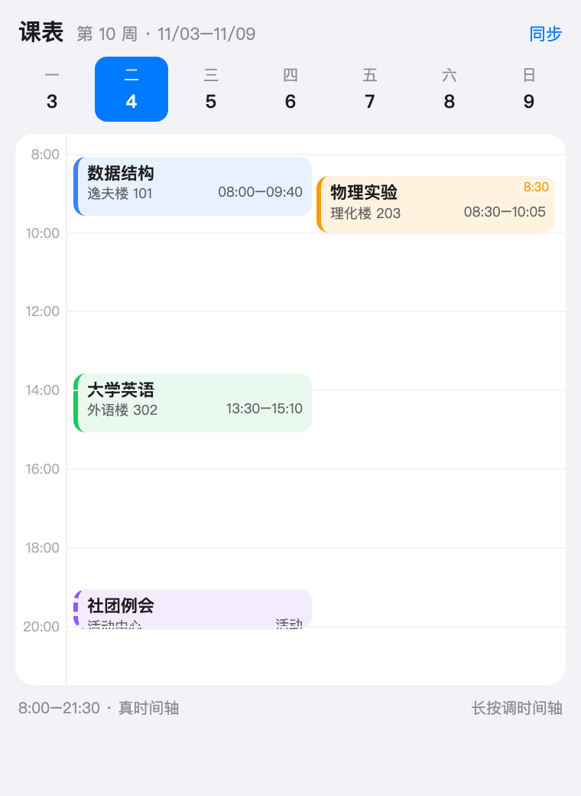

# 课表 × 日程：JLU Gate 集成方案（v0.3 讨论稿）

> **状态**：方案讨论稿，尚未写代码。
> **v0.3 增补**（2026-11-05）：学期日历（几周/第一周哪天/每周起始日）、课程起止周、显示开关、作息表细到每一节（节数/课间/放学）、开机提醒下一节课。
> **v0.2 变更**（2026-11-05，按你的三条新要求重写）：
>
> | 上一版 | 这一版 | 为什么 |
> |---|---|---|
> | 独立窗口 + WKWebView 登录 | **380 面板内 + 原生扫码** | 产品初衷不是做独立窗口；且 380 里的网页登录页实测很难看（见 §4.6） |
> | 网页登录后截 XHR | **原生 CAS 会话 + 原生 JSON 接口** | 实测 `iedu` 公网可达、`wdkb` 直接 302 到 CAS；接口本来就是 JSON |
> | 固定「节次网格」 | **真时间轴 + 方格流两种视图** | 课程可能晚半小时、对不齐；380 也塞不下 7×12 |
> | 一次性导入 | 多学期归档 + 三方合并 | 你的第二条要求 |

---

## 0. 结论

| 问题 | 结论 |
|---|---|
| 能不能记住地址直接进？ | 能。`https://iedu.jlu.edu.cn/jwapp/sys/wdkb/*default/index.do#/xskcb` 存为默认入口 |
| 未登录怎么办？ | 实测该地址会 302 到 `cas.jlu.edu.cn/tpass/login?service=<原地址>`；登录后原路返回，补 `#/xskcb` 就是课表 |
| 登录能不能不弹窗、不嵌网页？ | **能，而且学校主推的扫码正好适合**：二维码内容、轮询接口都已抓到（§4.6），可以在面板里原生画 QR、原生轮询 |
| 要不要预填账号密码？ | 字段是 `#un`/`#pd`，可以填；但**当前密码模板没有图形验证码**（验证码在「手机登录」tab），且密码提交用了学校自定义 DES，**不是标准 3DES**（已实测），所以"预填"容易、"原生提交"要单独移植 |
| 能不能塞进 380 面板？ | 能：**周方格流**看全周 + **单日真时间轴**看细节，都不需要二维网格 |
| 不规整的课怎么办？ | 时间轴按**真实分钟**排，节次只是参考线；08:30 的课就画在 08:30，不强行对齐，重叠就并排 |
| 更新/多学期？ | 一个 `timetable.json` 存 N 个学期；重新同步走三方合并，手改不被覆盖 |
| 最大风险？ | 不是 WebView 了（这版不用它）。是：**扫码成功后的回调细节**、**密码登录的二次验证**、**教务接口字段变化** |

---

## 0.1 先说难听的：值不值得做

- 只想"看课表"：手机上的 WakeUp、开源 [JLU_schedule](https://github.com/JFyuhong/JLU_schedule) 都能用。
- JLU Gate 的增量：登录态/校园网/入口/提醒在一个 App；菜单栏一眼看到"下一节"；课表变动能和网络状态一起解释。
- 代价：一个新子系统（约 15–20 人日）+ 一条长期维护面。
- 可裁剪：只做 **M1+M2**（导入 + 同步 + 只读展示）约 1 周多；编辑和活动后加。

---

## 1. 需求（含本轮新增）

| # | 用户故事 | 验收 |
|---|---|---|
| U1 | 记住课表地址，一键直达 | 首次填一次，之后点「课表」就开 |
| U2 | 没登录自动跳登录，登录完直接看到课表 | 302 → CAS → 回跳 → 补 `#/xskcb` |
| U3 | 登录后能导入 | 「导入本学期（32 门）」→ 预览 → 落库 |
| U4 | 时间/格子/周次都能改 | 点方块改、拖时间、改周次 |
| U5 | 颜色稳定好看 | 同名同色、跨学期一致、可手改 |
| U6 | 能加活动 | 一次性/每周/全天，可提醒 |
| U7 | 能反复更新 | 同步 → diff → 合并，手改不丢 |
| U8 | 多学期并存 | 学期列表切换，历史不删 |
| U9 | 规则模式下能用 | 预检 + DIRECT 规则提示 |
| U10 | **不规整的课不被强行对齐** | 08:30 的课画在 08:30；重叠并排；可标「偏轴」 |
| U11 | **时间轴本身可调** | 改起止、缩放、改节次表；改完所有课自动重算 |
| U12 | **全部在 380 面板里完成** | 不出现独立窗口（v1 硬约束） |
| U13 | 登录界面能预填 | 网页登录时填 `#un`/`#pd`；原生表单直接带出账号密码 |

---

## 2. 约束

| 约束 | 影响 |
|---|---|
| 380pt popover，**v1 不开独立窗口** | 不能做 7×12 大网格；编辑用内联卡片；登录不能靠大网页 |
| WKWebView 历史崩溃 | v1 尽量不用 WebView；扫码/接口都走原生 |
| Core 不 import 网络 | 解析/合并/时间轴/配色全放纯逻辑 target |
| DrCOM 冻结 10 个文件 | 新文件随便加，别碰旧的 |
| 无三方依赖 | QR 用 CoreImage，HTTP 用 URLSession |
| 文案三语 + `CopyTests` 写死 711 | 新文案要同步三张表并改数字 |
| `App/` 与 `App-Compat/` 两份源码 | View 要放两遍，逻辑下沉 |
| MIT 仓库 | 参考实现是 GPL-3.0，只参考行为，不抄代码 |

---

## 3. 调研（结论没变，压缩）

| 方案 | 学到什么 |
|---|---|
| [JLU_schedule](https://github.com/JFyuhong/JLU_schedule)（吉大，GPL） | 吉大接口链、字段、周次表达式；WebView 捕获 vs 原生二跳；多课表/备份/小组件 |
| [AiScheduleForNewJLU](https://github.com/Temsys-Shen/AiScheduleForNewJLU) | 新教务页面可解析；但一次性导入、页面一改就废 |
| [ClassIsland](https://docs.classisland.tech/app/profile/) | 「课表 / 时间表 / 科目」三层；时间表可复用、可单独改 |
| WakeUp / 超级课程表 | 周视图、配色、多课表、小组件；ICS/JSON 是事实交换格式 |
| [classCrawl](https://github.com/inannan423/classCrawl) | "能拿 JSON 就别抓 HTML"的普遍经验 |

三条经验：**优先 JSON；登录只产出 Cookie；一次性导入的产品活不久。**

---

## 4. 吉大链路（含本轮实测）

### 4.1 地址

| 用途 | 地址 |
|---|---|
| 课表页 | `https://iedu.jlu.edu.cn/jwapp/sys/wdkb/*default/index.do#/xskcb` |
| 门户 | `https://iedu.jlu.edu.cn/jwapp/sys/emaphome/portal/index.do` |
| CAS | `https://cas.jlu.edu.cn/tpass/login?service=<encoded>` |
| 当前学期 | `POST .../wdkb/modules/jshkcb/dqxnxq.do` |
| 整学期课表 | `POST .../wdkb/modules/xskcb/cxxszhxqkb.do`，body `XNXQDM=<学期码>` |

### 4.2 302 链（实测）

```
GET https://iedu.jlu.edu.cn/jwapp/sys/wdkb/*default/index.do
  → 302 Location: https://cas.jlu.edu.cn/tpass/login?service=https%3A%2F%2Fiedu.jlu.edu.cn%2Fjwapp%2Fsys%2Fwdkb%2F%2Adefault%2Findex.do
  → Set-Cookie: route=...
GET https://cas.jlu.edu.cn/tpass/login?...
  → 200, Set-Cookie: tpasssessionid=...; UqZBpD3n=...
```

所以"登录后直接显示课表"是天然的：**service 就是课表地址本身**，登录成功 CAS 会把浏览器送回它。`#/xskcb` 只是前端路由，我们回跳后补一句 `location.hash` 即可。

### 4.3 返回结构

```json
{"datas":{"xskcb":{"rows":[
  {"KCM":"数据结构","SKJS":"张三","YPSJDD":"1-16周 星期一 第1-2节 逸夫楼101",
   "ZCMC":"1-16周","SKXQ":"1","KSJC":"1","JSJC":"2",
   "JASMC":"逸夫楼101","JXLDM_DISPLAY":"逸夫楼",
   "XNXQDM":"2025-2026-1","XNXQDM_DISPLAY":"2025-2026学年第一学期","XF":"3.0"}
]}}}
```

| 字段 | 用法 |
|---|---|
| `KCM` / `SKJS` | 课程名/教师；身份键 |
| `YPSJDD` | 主解析源（多段拼接） |
| `ZCMC` | 周次兜底 |
| `SKXQ`/`KSJC`/`JSJC` | 星期/起止节兜底 |
| `JASMC`/`JXLDM_DISPLAY` | 教室/教学楼 |
| `XNXQDM` | 学期归档依据 |

### 4.4 节次（官方表，2023–2024 第二学期起）

| 节 | 时间 | 节 | 时间 |
|---|---|---|---|
| 1 | 08:00–08:45 | 7 | 15:30–16:15 |
| 2 | 08:55–09:40 | 8 | 16:25–17:10 |
| 3 | 10:00–10:45 | 9 | 18:20–19:05 |
| 4 | 10:55–11:40 | 10 | 19:05–19:50 |
| 5 | 13:30–14:15 | 11 | 20:00–20:45 |
| 6 | 14:25–15:10 | 12 | 20:45–21:30 |

> 参考实现内置的表是"连续"的（8:45 就上第二节），和官方不一致——这就是"时间轴必须可调"的现实理由。

### 4.5 周次表达式

`1-16周` / `1-16周(单)` / `1,3,5,7周` / `2-8周,10-16周` / `待定`。
认不出就保留原文 + 标黄，不猜。

### 4.6 本轮实测记录（2026-11-05，本机、非校园网）

| # | 实测 | 结果 |
|---|---|---|
| 1 | `cas.jlu.edu.cn` | 200，标题「智慧校园」；公网可达 |
| 2 | `iedu.jlu.edu.cn` | 公网可达；`/` 302 到门户；`wdkb` 302 到 CAS |
| 3 | CAS 三个 tab | 扫码登录（默认）/ 密码登录 / 手机登录 |
| 4 | 密码模板 | 只有 `#un`、`#pd`，**没有图形验证码**；验证码在「手机登录」tab（`#code`、`/tpass/code`） |
| 5 | 密码提交 | `rsa = strEnc(un+pd+lt,'1','2','3')`，表单 POST；`des.js` 是学校自定义实现 |
| 6 | `strEnc('test','1','2','3')` | `D8D35E5019288C41`，与标准 3DES-ECB（`c80c8db3…`）**不一致** → 移植要按它的位序来 |
| 7 | 扫码二维码内容 | `https://cas.jlu.edu.cn/tpass/qyQrLogin?uuid=<uuid>&service=<编码后前100字符>` |
| 8 | 扫码轮询 | 每 3s `GET /tpass/checkQRCodeScan?uuid=...`；未扫码返回空 body；成功后页面直接 reload |
| 9 | `qyQrLogin` | 302 到 `open.weixin.qq.com` 企业微信 OAuth（appid `ww3b03…`） → 扫码走「智慧吉大」 |
| 10 | 380 宽下的 CAS 页 | 横向溢出，tab 被切、字号巨大（见下图）→ 不适合直接嵌面板 |

**仍未验证**：扫码成功那一刻轮询返回什么、reload 后是否直接 302 到 iedu、密码登录是否还要微信二次验证、Cookie 名称与有效期。

### 4.7 待真机验证

| # | 未知 | 怎么验 |
|---|---|---|
| V1 | 扫码成功后轮询的返回与 Set-Cookie | 真机扫一次，抓包 |
| V2 | reload 后是否 302 到 iedu（建立会话） | 同上 |
| V3 | 密码登录是否需要微信二次验证 | 真机用错/对密码各试一次 |
| V4 | `cxxszhxqkb.do` POST/GET、参数大小写 | DevTools 抓页面自己的请求 |
| V5 | 一次是否返回整学期（不是单周） | 看 `YPSJDD` 的行数与周次 |
| V6 | 历史 `XNXQDM` 能否拉往期 | 改参数试 |
| V7 | `iedu` 是否真的"仅校内" | 校外网络再试一次 |

---

## 5. 架构（v1：没有 WebView、没有窗口）

```
┌──────────────────── JLU Gate 菜单栏面板 (380) ────────────────────┐
│  课表 tab                                                          │
│   ├─ 未登录：QR 卡（原生画码 + 轮询） / 账号密码卡（原生表单）      │
│   ├─ 已登录：周方格流 ⇄ 单日时间轴 / 导入预览 / 编辑卡              │
│   └─ 状态条：校园网 / 代理 / 会话 / 同步                            │
└───────────────┬───────────────────────────────┬───────────────────┘
                │                               │
      ┌─────────▼─────────┐           ┌─────────▼──────────┐
      │ JLUGateSchedule   │           │ JLUGateNet         │
      │ 纯逻辑，可离线测   │           │ CasQRLogin         │
      │ Model / Parser    │           │ JwxtClient         │
      │ TimeAxis / Merge  │           │ CampusSession      │
      │ Color / ICS       │           │ Preflight          │
      └─────────┬─────────┘           └─────────┬──────────┘
                └──────────────┬────────────────┘
                     ┌─────────▼──────────┐
                     │ TimetableStore     │
                     │ actor + 原子写 + 快照│
                     └────────────────────┘
```

**关键决定**：登录不是"打开一个网页"，而是"**用 HTTP 完成 CAS 会话**"，产物只有一份 Cookie。这样：

- 不需要 WKWebView，历史崩溃风险归零；
- 不需要窗口，全部内容在 380 面板；
- 扫码（学校主推）和密码（备选）只是两种"拿 Cookie"的方式。

### 5.1 新增文件

| 文件 | 层 | 职责 |
|---|---|---|
| `Sources/JLUGateSchedule/Model.swift` | Schedule | `TimetableArchive` / `Semester` / `Course` / `Meeting` / `WeekPattern` / `Event` |
| `.../TimeAxis.swift` | Schedule | 分钟↔y、节次参考线、重叠分列、不规整判定 |
| `.../PeriodProfile.swift` | Schedule | 作息表（可编辑、多套） |
| `.../JwxtParser.swift` | Schedule | `datas.*.rows` → `ImportedSemester`；周次/时间解析 |
| `.../TimetableMerge.swift` | Schedule | 三方合并、diff、冲突 |
| `.../ColorPalette.swift` | Schedule | 稳定配色、对比度 |
| `.../ICSExport.swift` | Schedule | 导出 `.ics` |
| `Sources/JLUGateNet/CasQRLogin.swift` | Net | UUID、二维码 URL、轮询、会话判定 |
| `Sources/JLUGateNet/CasPasswordLogin.swift` | Net | 可选：表单 POST（需 DES 移植） |
| `Sources/JLUGateNet/JwxtClient.swift` | Net | `dqxnxq` + `cxxszhxqkb` + 错误分类 |
| `Sources/JLUGateNet/CampusSession.swift` | Net | Cookie 持久化（Keychain/0600） |
| `Sources/JLUGateNet/TimetablePreflight.swift` | Net | 路由/可达性预检 |
| `App/Sources/Timetable*.swift` | App | 登录卡、周视图、日视图、编辑卡、同步预览 |

---

## 6. 登录

### 6.1 主路径：原生扫码（推荐）

```
1) GET  https://cas.jlu.edu.cn/tpass/login?service=<wdkb URL>   ← 拿 tpasssessionid
2) uuid = UUID()
3) 面板画二维码：https://cas.jlu.edu.cn/tpass/qyQrLogin?uuid=<uuid>&service=<encoded 前100>
4) 每 2s：GET /tpass/checkQRCodeScan?uuid=<uuid>&random=<r>
5) 轮询返回非空（或状态变化）→ GET 第 1 步的登录 URL
6) 若 302 到 iedu → 会话建立；否则回到 3 重新生成
7) POST dqxnxq.do → XNXQDM
8) POST cxxszhxqkb.do → 课表 JSON
```

- 二维码用 CoreImage `CIFilter.qrCodeGenerator` 生成，153×153，面板里正好；
- 状态：等待扫码 / 已扫码（如果接口给）/ 成功 / 失效（60s 换码）；
- 扫码成功后如果 CAS 不认（少见），退回"网页登录"。

**为什么这是最合适的**：学校把扫码放在第一个 tab；它不需要密码、不需要验证码、不需要 WebView；面板里一张 QR + 一行状态就够。

### 6.2 备选：账号密码（原生表单 + 预填）

- 面板里放一个 3 行表单：账号（从 `config.account` 预填）、密码（从 `CredentialStore` 预填，默认隐藏）、[登录]；
- **预填是确定的**：`#un` / `#pd` 都在 DOM 里；原生表单更是直接带值；
- **难点在提交**：需要复刻 `strEnc`。实测它**不是标准 3DES**（§4.6 #6），得按 `des.js` 的位序移植，约 1–2 天（含用 Node 生成向量做对拍）；
- **未知**：密码后是否还要微信二次验证（页面提示"密码登录：微信验证码通过智慧吉大发送"）。

**建议**：M2 先只做扫码；密码放 M2.5，做完 DES 再上线。在没做完之前，密码入口点了显示"请先用扫码登录"（而不是假装能用）。

### 6.3 最后手段：网页登录

如果哪天 CAS 加了新验证（滑块、二次确认），或者用户就是不想扫码：

- 打开 `WKWebView` 加载 CAS 页，自动切到密码 tab 并预填 `#un`/`#pd`（**不自动提交**）；
- v1 硬约束是"不开独立窗口"，所以它只能放在面板内 —— 但面板里 380 宽实测很难看（§4.6 #10）；
- 因此：**默认不做**。真要做，先解决"面板内 WebView 不崩"（M0 里顺手验一下），再决定放面板还是 sheet。

### 6.4 会话与安全

- Cookie 存 `CampusSession`：正式签名 → Keychain；ad-hoc → 0600 文件；
- 提供「退出登录」清 Cookie；
- 日志不打印 Cookie/密码/课程名；
- 不做后台轮询；只在用户点「课表」或「同步」时发请求；
- 不做证书绕过；`iedu` 目前是正常证书（实测 200），若将来不受信，只对 `*.jlu.edu.cn` 做一次性指纹确认。

### 6.5 规则模式预检

| 路由 | 探测 | 提示 |
|---|---|---|
| direct / ruleSplit | 通 | 直接进 |
| global | 通 | "能用，但慢；建议 `DOMAIN-SUFFIX,jlu.edu.cn,DIRECT`" |
| global | 不通 | 复制 `DOMAIN-SUFFIX,jlu.edu.cn,DIRECT` + `IP-CIDR,10.0.0.0/8,DIRECT` |
| direct | 不通 | 先连校园网；校外可直接试（实测公网可达），不行再用 WebVPN |

---

## 7. 数据模型

### 7.1 存储

```
~/Library/Application Support/JLUGate/timetable/
├── timetable.json           # 全部学期，0600，原子写
├── timetable.backup.json
└── snapshots/               # 最近 10 次提交前
```

### 7.2 结构（关键部分）

```swift
public struct TimetableArchive: Codable, Sendable {
    public var schemaVersion = 1
    public var semesters: [Semester] = []
    public var activeSemesterID: UUID?
    public var periodProfiles: [PeriodProfile] = [.jluDefault]
    public var colorOverrides: [String: Int] = [:]
}

public struct Semester: Codable, Sendable, Identifiable {
    public var id: UUID
    public var code: String?             // "2025-2026-1"
    public var title: String
    // ── 学期日历（三个都能改）──
    public var firstWeekStart: String    // 第 1 周第 1 天的日期，如 "2025-09-01"
    public var weekStartsOn: Int         // 1=周一 … 7=周日（只影响分栏和"本周"边界）
    public var weekCount: Int            // 一共几周，默认 20
    public var periodProfileID: UUID
    public var courses: [Course]
    public var events: [ScheduleEvent]
    public var overrides: [SessionOverride]
    public var importMeta: ImportMeta?
}

/// 作息表：节数、每节起止、课间、放学
public struct PeriodProfile: Codable, Sendable, Identifiable {
    public var id: UUID
    public var name: String              // "本部 · 春秋" / "某校区"
    public var periods: [Period]         // 有序；数量 = 一天几节（1...16）
    public var gapLabels: [Int: String]  // afterPeriod -> "午休" / "晚餐"（可选）
    public var dismissLabel: String      // 最后一节结束 = 放学
}

public struct Period: Codable, Sendable, Hashable {
    public var index: Int                // 1...N
    public var startMinute: Int          // 距 00:00，08:00 = 480
    public var endMinute: Int            // 08:45 = 525
    // 相邻两节的课间 = 下一节.start - 本节.end
    // 最后一节之后**没有**课间：那是放学
}

/// 只看不改的显示偏好
public struct DisplaySettings: Codable, Sendable {
    public var showOffWeekCourses = true   // 非本周：淡显；关掉就完全不画
    public var showSaturday = true
    public var showSunday = false
    public var defaultView: ViewMode = .week
}

/// 一门课的时间：常规按节次，特殊按真实钟点
public enum MeetingTime: Codable, Sendable, Hashable {
    case periods(start: Int, end: Int)     // 1...12，交给作息表换算
    case clock(startMinute: Int, endMinute: Int)  // 08:30–10:05，不规整
}

public struct Meeting: Codable, Sendable, Identifiable {
    public var id: UUID
    public var weekday: Int
    public var weeks: WeekPattern
    public var location: String
    public var time: MeetingTime
    public var note: String
    public var edits: [String: FieldEdit]
}
```

**为什么用枚举**：常规课跟着作息表走（改作息自动重算），特殊课保存真实钟点（永远不规整）。两种都能画在同一条时间轴上。

### 7.3 周次

```swift
public struct WeekPattern: Codable, Sendable, Hashable {
    public var ranges: [WeekRange]
    public var parity: Parity        // all / odd / even
    public var unknownText: String?  // "待定"
    public func weekSet() -> Set<Int>
}
```

### 7.4 三方合并的关键

```swift
public struct FieldEdit: Codable, Sendable {
    public var value: String                 // 我改成的值
    public var importedValueAtEdit: String?  // 我改的时候学校是什么
    public var at: Date
}
```

没有 `importedValueAtEdit` 就分不清"谁改的"，只能覆盖用户。

---

## 8. 导入 / 更新 / 多学期

（与 v0.1 一致，压缩）

- 管线：`JSON → JwxtParser → ImportedSemester → Merge → 预览 → 提交（先快照）`；
- 身份键：课程 = `KCM + SKJS`；时段 = 课程 + 周几 + 起止；地点/周次是属性；
- 合并矩阵：没改过→跟学校；改过且学校没动→留；改到一处→收敛；都改→冲突（默认留我）；
- 预览：`＋2 ～3 －1 ⚠1`，可"全部采用学校/只应用无冲突/逐项"；
- 多学期：`XNXQDM` 决定写哪个学期；不存在就新建；历史只增不删；可"从上一学期复制"；
- 自动同步默认关；有变化只提示，不自动应用。

---

## 9. 显示与纠错（本轮重点）

### 9.1 两个视图，都塞得进 380

**A. 周方格流（默认）**

```
周一 3   [数据结构 08:00] [物理实验 08:30 偏轴] [大学英语 13:30]
周二 4   [高等数学 10:00] [社团例会 19:00 活动]
...
```

- 7 行 × 每行若干 70×56 的方块；
- 方块里只有课名 + 时间（+ 偏轴/活动角标）；
- 完全不依赖坐标轴 → 不规整时间天然成立；
- 一眼看全周，380 宽刚好。


**B. 单日真时间轴**

```
08:00 ┤ ┌──────────────┐
      │ │ 数据结构      │ ┌──────────────┐
09:00 ┤ └──────────────┘ │ 物理实验 8:30 │
      │                  └──────────────┘
10:00 ┤
```

- y 轴 = **真实分钟**，不是节次序号；
- 节次线只是参考线（可关）；
- 08:30 的课就画在 8:30，露出参考线之外 → 一看就知道"这节不规整"；
- 重叠的课自动并排（lane）；
- 上下滑动/捏合缩放时间范围。

> 这直接回答"不要盲目让所有课强行对齐"：**对齐是参考，不是规则**。



### 9.2 时间轴可调

| 可调项 | 入口 | 效果 |
|---|---|---|
| 一天显示范围 | 日视图上下拖 / 设置 | 07:30–22:00 变 08:00–21:00 |
| 缩放 | 捏合 / 密度按钮 | 紧凑/舒适 |
| 节次表 | 设置 → 作息 | 改起止、增删节、多套（本部/校区/夏季） |
| 单节课时间 | 点方块 → 时间 | 按节次 ↔ 按钟点 切换 |
| 学期日历 | 学期设置 | 第一周开始日 / 每周起始日 / 总周数，改完周次与日期全部重算 |

改作息时：`periods` 类型的课自动跟着变；`clock` 类型的课不动（它本来就不规整）。

### 9.3 不规整的视觉语言

| 状态 | 表现 |
|---|---|
| 常规（按节次） | 左色条 + 正常圆角 |
| 偏轴（钟点与节次对不上） | 左色条变虚线 + 时间文字橙色 + 小角标"偏轴" |
| 与别人重叠 | 并排 + 细分割线（不遮字） |
| 非本周 | 35% 透明 + 虚线框 |
| 临时调课 | 角标"调"；停课划线；补课虚线 |
| 活动 | 紫色虚线边 + "活动"角标 |

### 9.4 编辑（都在面板内，内联卡片）

| 操作 | 结果 |
|---|---|
| 点方块 | 下方展开编辑卡：课名/教师/地点/周次/颜色/时间 |
| 时间 | 两个模式：按节次（1–12 选择器）/ 按钟点（时间选择器） |
| 拖方块（日视图） | 改时间；松手问"仅本周 / 此后 / 整门" |
| 拉边缘 | 改节数/时长 |
| 长按 | 快捷菜单：复制、隐藏、改色、删除 |
| 周次 | 1–20 方格 + 文本框双向同步（`1-8,10-16(单)`） |
| 冲突 | 允许并存，编辑卡里列冲突对象 |

### 9.5 临时调整层

`SessionOverride`：停课 / 调课 / 补课，按日期存，不动模板；导出 ICS 时展开。

### 9.6 学期与周次（回答你的三个问题）

| 设置 | 默认 | 说明 |
|---|---|---|
| 一学期几周 | **20 周** | 1…30 可改；周次选择器的上限；调大不丢数据 |
| 第一周从哪天开始 | 从学期码推断：秋季 ≈ 9 月第一个周一；春季 ≈ 2 月最后一个周一 | **第一次导入时弹一次确认**，显示"第 1 周 9/1–9/7"；可手动改 |
| 每周从周几开始 | **周一** | 可选周日；只影响分栏顺序与"本周"边界，不影响周次编号 |
| 学期结束 | 自动 = 第一周开始 + 周数×7 − 1 | 只读展示 |

课程周次编辑（点方块 → 编辑卡）：

```
周次   第 [ 1 ] 周  →  第 [16] 周     ☐ 单周  ☐ 双周
       [更多]  自定义：1-8,10-16(单)
```

- 默认就是"起始周 / 结束周"两个 stepper，覆盖 90% 场景；
- 单双周、离散周、多段周放"更多"里，文本框与方格双向同步；
- 校验：起始 ≤ 结束，范围落在 `1...weekCount`；超出只警告不丢数据；
- 展示：`1–16 周`、`1–16 周（单）`、`1,3,5–9 周`。

### 9.7 作息表：节数、课间、放学

编辑的是 `PeriodProfile`，不是每门课。改完所有 `periods` 课自动重算，`clock` 课不动。

```
节次   开始    结束    之后
 1    08:00   08:45   课间 10 分钟
 2    08:55   09:40   课间 20 分钟
 3    10:00   10:45   课间 10 分钟
 4    10:55   11:40   午休 110 分钟
 5    13:30   14:15   课间 10 分钟
 …
 9    18:20   19:05   课间 0 分钟   ← 晚上两小节之间不休息
10    19:05   19:50   课间 10 分钟
11    20:00   20:45   课间 0 分钟
12    20:45   21:30   **放学**      ← 不是课间
```

- **节数**：默认 12，1…16 可增删；删掉的节如果被课程引用，先提示再改；
- **每节起止**：5 分钟粒度，可单节微调，也可"从第 N 节起整体 +5 分钟"；
- **课间**：相邻两节的空隙，改它默认顺延后面所有节（有开关可只改这一段）；
- **放学**：最后一节结束就是放学，**编辑器和时间轴都不给它加"休息"块**；时间轴到这儿就结束（最多留一点视觉留白）；
- **午休/晚餐**：长空隙可命名，显示在时间轴上，但不算"课间"；
- **多套作息**：本部/校区/夏季各一套，学期选一套；有"恢复官方表"。


### 9.8 显示开关

| 开关 | 默认 | 行为 |
|---|---|---|
| 显示非本周课程 | **开** | 淡显（35% + 虚线）；关掉就完全不画，周视图更干净 |
| 显示周六 | **开** | 关掉后整列隐藏；若当天有课，底部提示"周六有 2 节，已隐藏 [显示]" |
| 显示周日 | **关** | 同上 |

三个开关存在 `DisplaySettings`，全局生效（不随学期变）；改动立即重绘，不用重新导入。

---

## 10. 颜色

- `colorKey = 归一化课名`，`index = stableHash % 12` → 同名同色、跨学期稳定；
- 撞色 + 黄金角扰动；
- 浅色/深色两套色板；文字颜色按相对亮度算；
- 手改色存 `colorIndex`，同步不覆盖；
- 状态（偏轴/非本周/冲突/调课）用形状+文字，不只靠颜色；
- 高对比开关。

---

## 11. 活动

- `ScheduleEvent`：一次性 / 每周 / 按周次 / 全天；`semesterID = nil` 表示长期；
- 与课程共用两个视图，紫色虚线样式；
- 提醒：`UNUserNotificationCenter`，只排未来 7 天；
- 导出 ICS；可选 EventKit（后续）。

---

## 12. 面板信息架构

```
[课表]  ← 主面板新增入口（与"站点/体检"并列）

未登录：
┌ 课表 ─────────────────────┐
│ 第 10 周 · 11/03–11/09    │
│ ┌───────────────────────┐ │
│ │      [ 二维码 ]        │ │
│ │   用智慧吉大扫码        │ │
│ │   等待扫码…            │ │
│ └───────────────────────┘ │
│ 账号密码登录 ›             │
│ 校园网 ✓ · 规则模式 ✓      │
└───────────────────────────┘

已登录：
┌ 课表 ─────────────────────┐
│ 第 10 周   [周][日]  同步  │
│ 周一 3  ███ ███ ███       │
│ 周二 4  ███ ███           │
│ …                          │
│ 下一节 13:30 大学英语      │
│ [导入/更新] [＋活动]       │
└───────────────────────────┘
```

- 无窗口、无 sheet、无 WebView（密码原生表单也在面板内）；
- 编辑卡从底部滑入，替代弹窗；
- 首次引导三步走：扫码 → 拉取 → 预览。

### 12.1 下一节课 & 开机提醒

**面板里**：顶部一行"下一节 13:30 大学英语 · 外语楼302（还有 35 分钟）"，点一下进日视图。

**通知**（你要的"刚开机提醒"）：

| 项 | 做法 |
|---|---|
| 触发点 | App 启动（开机自启已开）、从睡眠唤醒（`NSWorkspace.didWakeNotification`）；**不轮询** |
| 算什么 | 今天剩下的课（先按本周筛选，再套临时调整），取最近一节；活动默认不算 |
| 条件 | 开关开 + 有通知权限 + 距开课 ≤ 6 小时 + 今天这一节没提醒过 |
| 文案 | "今天下一节 **13:30 大学英语** · 外语楼302（还有 35 分钟）" |
| 没课 | 不打扰（可选"今天没课了"，默认关） |
| 去重 | `yyyy-MM-dd + meetingID` 存 UserDefaults，重启不重复 |
| 权限 | 沿用 `Notifier.requestAuthorizationIfNeeded()`；首次开启开关时请求 |

---

## 13. 里程碑（v0.3）

| 阶段 | 内容 | 验收 | 估时 |
|---|---|---|---|
| **M0 验证** | ① 真机扫码一次，抓 `checkQRCodeScan` 成功返回 + reload 后的 302；② 用 CasCookie 拉 `cxxszhxqkb.do` 得到 JSON；③ 380 面板里画 QR + 轮询 + 状态；④ 确认密码是否需要二次验证 | 一份验证记录；决定密码路径 | 1–2 天 |
| **M1 数据/时间轴** | 模型、周次解析、`YPSJDD` 解析、`PeriodProfile`、`TimeAxis`（分钟↔y、重叠分列）、存储 | 单测全绿；假数据能画两种视图 | 3–4 天 |
| **M2 扫码导入** | 原生 QR + 轮询 + Cookie + `dqxnxq` + `cxxszhxqkb` + 预览 + 提交 | 真机：打开→扫码→导入 | 3–4 天 |
| **M3 编辑/设置** | 内联编辑、拖拽、**起止周 / 学期日历 / 作息表（节数·课间·放学）/ 显示开关**、三方合并、快照/撤销、学期管理 | 改完再同步不丢；冲突可解；改作息后课表重算正确 | 6–7 天 |
| **M4 活动/提醒** | 事件、编辑器、**开机/唤醒"下一节"通知**、ICS | 能加活动；开机收到一次准确提醒 | 3–4 天 |
| **M5 打磨** | 两种视图切换、颜色、三语、无障碍、隐私、文档 | `make ci` 绿 | 3 天 |

合计 **19–23 人日**。M0 之后可砍 M3/M4 先上"只读 + 扫码 + 同步"。

---

## 14. 风险

| 风险 | 概率 | 影响 | 对策 |
|---|---|---|---|
| 扫码成功回调与预期不符 | 中 | 中 | M0 真机抓一次；失败退回密码/网页 |
| 密码登录要微信二次验证 | 中高 | 中 | 密码路径先不做；以扫码为主 |
| `strEnc` 移植出错 | 中 | 中 | 用 Node 生成向量对拍；失败就不做原生密码 |
| 教务接口改字段 | 中 | 中 | 解析容错 + 导入体检 + 保留原始 JSON |
| 380 面板信息密度不够 | 中 | 中 | 两种视图 + 可折叠；真机调 |
| 同步覆盖手改 | 中 | 高 | 三方合并 + 快照 + 撤销 |
| 隐私（Cookie/课表） | 低 | 高 | 0600/Keychain、日志脱敏、扫描脚本 |
| 双份 App/App-Compat | 中 | 低 | 逻辑下沉，UI 双份清单 |

---

## 15. 测试与隐私

- 单测：周次表达式、起止周校验、`YPSJDD` 多段、时间轴换算（分钟/节次/偏轴）、重叠分列、合并矩阵、配色稳定、ICS；
- 作息：节数增删、课间顺延、**最后一节之后不产生"休息"块**、跨午休的时间轴；
- 显示：周日隐藏但有课时的提示、非本周开关；
- 提醒：开机只发一次、同一天不重复、无课不发；
- 夹具全合成（张三/数据结构/逸夫楼101），真实响应只放 `/tmp`，验完删；
- 扫码/登录用手工验收清单（无法自动化）；
- 日志不出现 Cookie、密码、课程名；诊断导出不含课表。

---

## 16. 不做

抢课、成绩/考试（后续可复用会话）、自动提交、绕过验证码/二次验证、后台轮询、云同步、独立窗口（v1）。

---

## 17. 需要你拍板

1. **扫码能不能作为主路径**？（你已经在用「智慧吉大」吗？）
2. **密码登录**：接受"移植学校 DES 做原生"（1–2 天，无 WebView）吗？还是先不做密码、只留扫码？
3. **默认视图**：周方格流还是单日时间轴？（我倾向周方格流做默认，点某天进时间轴）

以下四条我先按默认写进方案了，觉得不对再说：

| 项 | 默认值 |
|---|---|
| 一学期几周 | **20 周**（可改 1–30） |
| 第一周从哪天开始 | 从学期码推断（秋 9 月第一个周一 / 春 2 月最后一个周一），**导入时确认一次** |
| 每周从周几开始 | **周一**（可选周日） |
| 显示 | 非本周**淡显**、周六**显示**、周日**隐藏**（有课会给提示） |
| 开机提醒 | **开**，只在 6 小时内有课时发一次 |

---

## 18. 验证产物

- [周方格流](mock/week-squares.png)：380×520，7 行方块
- [单日真时间轴](mock/day-axis.png)：含 8:30 偏轴课、重叠并排
- [课表设置](mock/settings.png)：学期日历 + 显示开关 + 作息表（含"放学"）
- [CAS 登录页 @380](mock/cas-380.png)：真实页面塞进面板的样子（说明为什么不做网页登录）


## 附录：抓真实响应（M0）

1. 校园网/公网均可，浏览器打开课表 URL → 登录（扫码最快）；
2. DevTools → Network → 过滤 `cxxszhxqkb` → 切周触发；
3. 右键 → Copy as cURL；响应存 `/tmp/jlu.json`；
4. 用最小脚本核对字段；
5. 验完删除，别 `git add`。

## 参考

- 作息表：<http://jwc.jlu.edu.cn/sksj.htm>
- 参考实现（GPL，仅行为参考）：<https://github.com/JFyuhong/JLU_schedule>
- 小爱适配：<https://github.com/Temsys-Shen/AiScheduleForNewJLU>
- ClassIsland 时间表模型：<https://docs.classisland.tech/app/profile/>
- ICS：<https://datatracker.ietf.org/doc/html/rfc5545>
